# Chapter 1 – Scalars and Vectors

**Weeks:** 1–2 | **CLO:** CLO1 | **Assessment:** Quizzes (Week 3), Test (Week 7), Final Exam

::: info Textbook Mapping
**Meriam & Kraige, 7th Ed. (SI): Chapter 1, Introduction to Statics**

- Mechanics, basic concepts, scalars and vectors
- Newton's laws, units, law of gravitation
- Problem solving in statics

Read the matching sections in the textbook and work the problems there. See [Textbooks](/resources/textbooks#meriam).
:::

## Learning Objectives

By the end of this chapter you should be able to:

- State Newton's three laws and the idealizations (particle, rigid body) used in statics.
- Use SI units consistently and check equations for dimensional homogeneity.
- Distinguish scalars from vectors, and add vectors graphically and by components, using the sine and cosine laws for force triangles.
- Resolve a vector into rectangular components in 2D and 3D.
- Use the dot product to find angles between vectors and projections.
- Use the cross product to compute the moment of a force about a point.

## Key Concepts

::: tip Real-World Application
Every force in a real structure is a vector. When an engineer checks a cable-stayed bridge, a crane or a roof, the first step is to resolve each force into components along convenient axes. Dot products give angles between members and the projection of a load along an axis, and cross products give moments about supports. A sign or direction error at this stage carries through every later calculation.
:::

### 1.1 General Principles of Engineering Mechanics

**Mechanics** is the branch of physics that studies the effect of forces on bodies. **Statics** deals with bodies at rest, or moving at constant velocity, so that the acceleration is zero.

#### Newton's three laws

1. **First law.** A particle remains at rest, or continues to move in a straight line at constant speed, unless acted on by an unbalanced force.
2. **Second law.** The acceleration of a particle is proportional to the resultant force and is in the direction of that force:

$$
\mathbf{F} = m\,\mathbf{a}
$$

3. **Third law.** The forces of action and reaction between two interacting bodies are equal in magnitude, opposite in direction, and collinear.

Newton's law of gravitation gives the attraction between two bodies of mass $m_1$ and $m_2$ separated by a distance $r$:

$$
F = G\,\frac{m_1 m_2}{r^2}
$$

Near the Earth's surface this gives the weight $W = mg$, with $g \approx 9.81\ \text{m/s}^2$.

#### Units and dimensions (SI)

The base quantities used in statics are length, mass and time. In SI these are the metre (m), kilogram (kg) and second (s). Force is a *derived* unit, the newton:

$$
1\ \text{N} = 1\ \text{kg}\cdot\text{m/s}^2
$$

| Prefix | Symbol | Factor |
|---|---|---|
| giga | G | $10^{9}$ |
| mega | M | $10^{6}$ |
| kilo | k | $10^{3}$ |
| milli | m | $10^{-3}$ |
| micro | $\mu$ | $10^{-6}$ |

Every valid equation must be **dimensionally homogeneous**: each term must have the same dimensions. Checking this is a quick way to catch algebra errors.

#### Idealizations

- **Particle:** a body with mass but negligible size. Use it when the size of the body does not affect the analysis, so all forces can be taken to act at one point.
- **Rigid body:** a body whose deformations are negligible compared to its overall size, so the distances between any two points on it stay constant. Statics treats bodies as rigid.
- **Concentrated force:** a load assumed to act at a single point, an idealization of a load spread over a very small area.

### 1.2 Scalars and Vectors

A **scalar** has magnitude only (mass, length, time, temperature). A **vector** has magnitude and direction and obeys the laws of vector addition (force, displacement, velocity). Vectors are written in bold, $\mathbf{A}$, and the magnitude is written $A$ or $|\mathbf{A}|$.

#### Vector addition

**Parallelogram rule.** Place $\mathbf{A}$ and $\mathbf{B}$ tail to tail and complete the parallelogram. The resultant $\mathbf{R}$ is the diagonal from the common tail.

**Triangle rule.** Place the tail of $\mathbf{B}$ at the head of $\mathbf{A}$. The resultant runs from the tail of $\mathbf{A}$ to the head of $\mathbf{B}$.

$$
\mathbf{R} = \mathbf{A} + \mathbf{B} = \mathbf{B} + \mathbf{A}
$$

If $\theta$ is the angle between $\mathbf{A}$ and $\mathbf{B}$ when drawn tail to tail, the magnitude of the resultant follows from the law of cosines:

$$
R = \sqrt{A^2 + B^2 + 2AB\cos\theta}
$$

#### Rectangular components

In 3D, with unit vectors $\mathbf{i}, \mathbf{j}, \mathbf{k}$ along $x, y, z$:

$$
\mathbf{A} = A_x\mathbf{i} + A_y\mathbf{j} + A_z\mathbf{k}, \qquad
A = \sqrt{A_x^2 + A_y^2 + A_z^2}
$$

In 2D, a vector of magnitude $A$ at angle $\alpha$ measured counter-clockwise from $+x$ has

$$
A_x = A\cos\alpha, \qquad A_y = A\sin\alpha
$$

The **unit vector** along $\mathbf{A}$ and its direction cosines are

$$
\mathbf{u}_A = \frac{\mathbf{A}}{A} = \cos\alpha\,\mathbf{i} + \cos\beta\,\mathbf{j} + \cos\gamma\,\mathbf{k},
\qquad \cos^2\alpha + \cos^2\beta + \cos^2\gamma = 1
$$

**Addition by components** is the most reliable method:

$$
\mathbf{R} = (A_x + B_x)\,\mathbf{i} + (A_y + B_y)\,\mathbf{j} + (A_z + B_z)\,\mathbf{k}
$$

#### Solving the force triangle: sine and cosine laws

When two forces are added with the triangle rule, the two forces and their resultant form a **triangle**. Any triangle with sides $a$, $b$, $c$ and opposite angles $A$, $B$, $C$ obeys two laws (here $A$, $B$, $C$ are angles of the triangle, not the vectors):

$$
\text{Law of sines:}\quad \frac{a}{\sin A} = \frac{b}{\sin B} = \frac{c}{\sin C}
$$

$$
\text{Law of cosines:}\quad c^2 = a^2 + b^2 - 2ab\cos C
$$

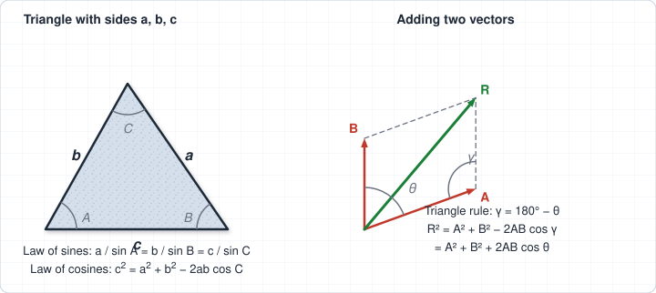

For vectors $\mathbf{A}$ and $\mathbf{B}$ drawn tail to tail with angle $\theta$ between them, the angle **inside** the force triangle is $\gamma = 180^\circ - \theta$, so the law of cosines gives

$$
R^2 = A^2 + B^2 - 2AB\cos\gamma = A^2 + B^2 + 2AB\cos\theta
$$

**Which law to use?**

| What you know | What you want | Use |
|---|---|---|
| Two forces and the angle between them | Resultant magnitude | Law of cosines |
| Resultant magnitude, then another side and its angle | Resultant direction | Law of sines |
| One side and two angles of the force triangle | The other two sides | Law of sines |

For three concurrent forces in equilibrium the forces form a **closed triangle**, and the law of sines becomes **Lami's theorem**: each force is proportional to the sine of the angle between the *other two* forces,

$$
\frac{F_1}{\sin\theta_{23}} = \frac{F_2}{\sin\theta_{31}} = \frac{F_3}{\sin\theta_{12}}
$$

::: warning Watch the angle
Use the angle **inside the force triangle** ($180^\circ - \theta$), not the tail-to-tail angle $\theta$, in the law of cosines when you write it as $R^2 = A^2 + B^2 - 2AB\cos\gamma$. When you use the law of sines to find an angle, two angles share the same sine ($x$ and $180^\circ - x$), so check which one fits the sketch, or confirm with components.
:::

### 1.3 Vector Operations

#### Dot (scalar) product

$$
\mathbf{A} \cdot \mathbf{B} = AB\cos\theta = A_xB_x + A_yB_y + A_zB_z
$$

The result is a **scalar**. Two uses in statics:

- **Angle between two vectors:**

$$
\theta = \cos^{-1}\!\left(\frac{\mathbf{A}\cdot\mathbf{B}}{AB}\right)
$$

- **Projection** (scalar component) of $\mathbf{A}$ along the direction of $\mathbf{B}$:

$$
A_B = \mathbf{A}\cdot\mathbf{u}_B = \frac{\mathbf{A}\cdot\mathbf{B}}{B}
$$

If $\mathbf{A}\cdot\mathbf{B} = 0$ (and neither is zero), the vectors are perpendicular.

#### Cross (vector) product

$$
\mathbf{A} \times \mathbf{B} = (A_yB_z - A_zB_y)\,\mathbf{i} + (A_zB_x - A_xB_z)\,\mathbf{j} + (A_xB_y - A_yB_x)\,\mathbf{k}
$$

This is the expansion of the determinant

$$
\mathbf{A} \times \mathbf{B} =
\begin{vmatrix}
\mathbf{i} & \mathbf{j} & \mathbf{k} \\
A_x & A_y & A_z \\
B_x & B_y & B_z
\end{vmatrix}
$$

The result is a **vector** perpendicular to both $\mathbf{A}$ and $\mathbf{B}$, with direction given by the right-hand rule and magnitude

$$
|\mathbf{A} \times \mathbf{B}| = AB\sin\theta
$$

The cross product is **not commutative**: $\mathbf{B}\times\mathbf{A} = -\,\mathbf{A}\times\mathbf{B}$.

#### Moment of a force

The moment of a force $\mathbf{F}$ about a point $O$ is

$$
\mathbf{M}_O = \mathbf{r} \times \mathbf{F}
$$

where $\mathbf{r}$ is a position vector from $O$ to *any* point on the line of action of $\mathbf{F}$. The magnitude is $M_O = Fd$, with $d$ the perpendicular distance from $O$ to the line of action. Its direction is perpendicular to the plane containing $\mathbf{r}$ and $\mathbf{F}$ and measures the tendency of the force to rotate the body about $O$.

::: warning Common Mistakes
- Mixing up the **dot product** (a scalar) and the **cross product** (a vector).
- Using the angle from the wrong axis when resolving a vector, so sine and cosine are swapped.
- Forgetting that the cross product is **not commutative**: $\mathbf{r}\times\mathbf{F} \neq \mathbf{F}\times\mathbf{r}$.
- Mixing units, for example kN with N or mm with m.
- Using the tail-to-tail angle instead of the **interior** angle ($180^\circ - \theta$) in the law of cosines, or taking the wrong angle when the law of sines gives two possibilities.
:::

## Worked Examples

### Example 1.1: Adding two 2D vectors by components

Two forces act on a bracket: $\mathbf{A}$ has magnitude 100 N at $30^\circ$ and $\mathbf{B}$ has magnitude 60 N at $135^\circ$, both measured counter-clockwise from $+x$. Find the resultant.

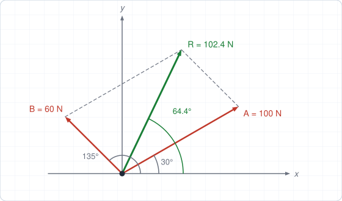

**Step 1: Resolve each force.**

$$
A_x = 100\cos 30^\circ = 86.60\ \text{N}, \qquad A_y = 100\sin 30^\circ = 50.00\ \text{N}
$$

$$
B_x = 60\cos 135^\circ = -42.43\ \text{N}, \qquad B_y = 60\sin 135^\circ = 42.43\ \text{N}
$$

**Step 2: Add components.**

$$
R_x = 86.60 - 42.43 = 44.18\ \text{N}, \qquad R_y = 50.00 + 42.43 = 92.43\ \text{N}
$$

**Step 3: Magnitude and direction.**

$$
R = \sqrt{44.18^2 + 92.43^2} = 102.4\ \text{N}, \qquad
\alpha = \tan^{-1}\!\frac{92.43}{44.18} = 64.4^\circ
$$

$$
\boxed{\mathbf{R} = 44.2\,\mathbf{i} + 92.4\,\mathbf{j}\ \text{N} \;=\; 102.4\ \text{N at } 64.4^\circ}
$$

### Example 1.2: Angle between two 3D vectors

Find the angle between $\mathbf{A} = 3\mathbf{i} + 4\mathbf{j} + 12\mathbf{k}$ and $\mathbf{B} = 2\mathbf{i} - 6\mathbf{j} + 3\mathbf{k}$.

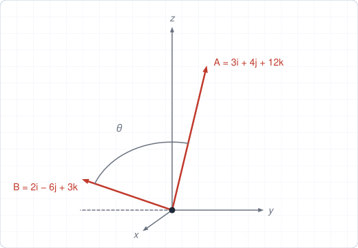

**Step 1: Dot product.**

$$
\mathbf{A}\cdot\mathbf{B} = (3)(2) + (4)(-6) + (12)(3) = 6 - 24 + 36 = 18
$$

**Step 2: Magnitudes.**

$$
A = \sqrt{3^2 + 4^2 + 12^2} = 13, \qquad B = \sqrt{2^2 + (-6)^2 + 3^2} = 7
$$

**Step 3: Angle.**

$$
\cos\theta = \frac{18}{(13)(7)} = 0.1978 \;\;\Rightarrow\;\; \boxed{\theta = 78.6^\circ}
$$

The projection of $\mathbf{A}$ on $\mathbf{B}$ is $A_B = 18/7 = 2.57$.

### Example 1.3: Moment of a force using the cross product

A force $\mathbf{F} = 20\mathbf{i} + 10\mathbf{j} - 30\mathbf{k}$ N acts at a point whose position relative to $O$ is $\mathbf{r} = 2\mathbf{i} + 3\mathbf{j} - 1\mathbf{k}$ m. Find $\mathbf{M}_O$.

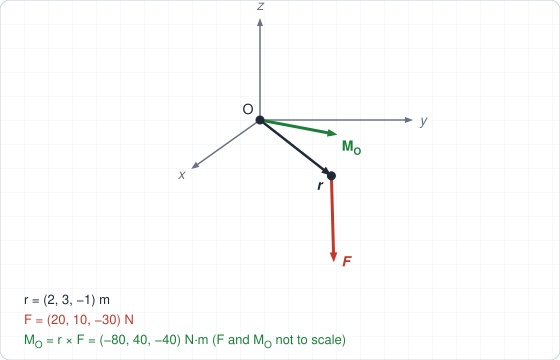

**Step 1: Set up the cross product.**

$$
\mathbf{M}_O = \mathbf{r}\times\mathbf{F} =
\begin{vmatrix}
\mathbf{i} & \mathbf{j} & \mathbf{k} \\
2 & 3 & -1 \\
20 & 10 & -30
\end{vmatrix}
$$

**Step 2: Expand.**

$$
M_x = (3)(-30) - (-1)(10) = -80
$$

$$
M_y = (-1)(20) - (2)(-30) = 40
$$

$$
M_z = (2)(10) - (3)(20) = -40
$$

$$
\boxed{\mathbf{M}_O = -80\,\mathbf{i} + 40\,\mathbf{j} - 40\,\mathbf{k}\ \text{N·m}}
$$

**Step 3: Magnitude and check.** $M_O = \sqrt{80^2 + 40^2 + 40^2} = 98.0$ N·m. As a check, $\mathbf{M}_O$ must be perpendicular to $\mathbf{r}$: $\mathbf{r}\cdot\mathbf{M}_O = -160 + 120 + 40 = 0$ ✓.

### Example 1.4: Force triangle (sine and cosine laws)

Two forces $F_1 = 400$ N and $F_2 = 300$ N act at a point with an angle of $60^\circ$ between them (tail to tail). (a) Find the resultant and its angle from $F_1$. (b) A 500 N load hangs from a ring held by two cables making $30^\circ$ (left) and $45^\circ$ (right) with the horizontal. Find the cable tensions.

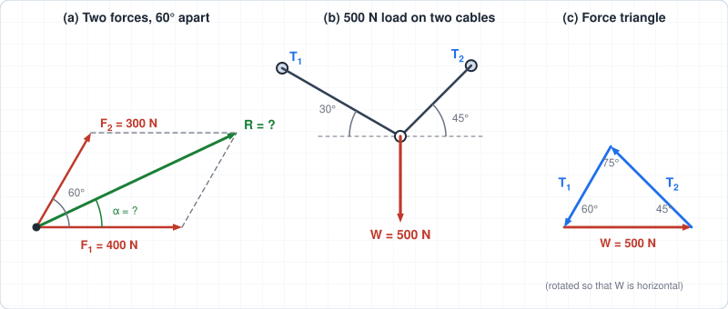

**Step 1: (a) Resultant magnitude** (law of cosines, $\gamma = 180^\circ - 60^\circ = 120^\circ$):

$$
R^2 = 400^2 + 300^2 + 2(400)(300)\cos 60^\circ = 160\,000 + 90\,000 + 120\,000 = 370\,000
$$

$$
R = 608.3\ \text{N}
$$

**Step 2: Direction** (law of sines, the angle $\alpha$ between $R$ and $F_1$ is opposite the 300 N side):

$$
\frac{\sin\alpha}{300} = \frac{\sin 120^\circ}{608.3} \;\Rightarrow\; \sin\alpha = 0.4271 \;\Rightarrow\; \alpha = 25.3^\circ
$$

**Check with components:** $R_x = 400 + 300\cos 60^\circ = 550$ N and $R_y = 300\sin 60^\circ = 259.8$ N give $R = 608.3$ N and $\tan^{-1}(259.8/550) = 25.3^\circ$ ✓.

**Step 3: (b) Force triangle.** The forces in the cables and the load are in equilibrium, so they form a closed triangle. Its interior angles are $75^\circ$ (opposite $W$), $45^\circ$ (opposite $T_1$) and $60^\circ$ (opposite $T_2$), found from the angles between the lines of action.

**Step 4: Law of sines.**

$$
\frac{500}{\sin 75^\circ} = \frac{T_1}{\sin 45^\circ} = \frac{T_2}{\sin 60^\circ}
$$

$$
T_1 = \frac{500\sin 45^\circ}{\sin 75^\circ} = 366\ \text{N}, \qquad T_2 = \frac{500\sin 60^\circ}{\sin 75^\circ} = 448\ \text{N}
$$

$$
\boxed{R = 608\ \text{N at } 25.3^\circ \text{ from } F_1; \qquad T_1 = 366\ \text{N},\ T_2 = 448\ \text{N}}
$$

**Check:** horizontal: $366\cos 30^\circ = 317$ N and $448\cos 45^\circ = 317$ N ✓. Vertical: $366\sin 30^\circ + 448\sin 45^\circ = 183 + 317 = 500$ N ✓.

### Example 1.5 (Real-world): Stay cables on a footbridge tower

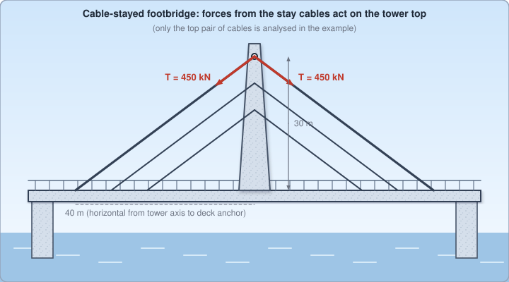

Each of the two top stay cables of a pedestrian cable-stayed bridge carries a tension $T = 450$ kN. A cable is attached to the tower 30 m above the deck and anchored on the deck 40 m (horizontally) from the tower axis. Find (a) the force of the right-hand cable on the tower as a vector, (b) the resultant of the two cables on the tower, and (c) the angle between the two cables.

**Step 1: Direction of each cable.** Take $x$ to the right and $y$ up, with the origin at the tower attachment. The vector from the tower to the right anchor is $\mathbf{r}_1 = 40\,\mathbf{i} - 30\,\mathbf{j}$ m, with $|\mathbf{r}_1| = \sqrt{40^2 + 30^2} = 50$ m, so

$$
\mathbf{u}_1 = \frac{\mathbf{r}_1}{50} = 0.8\,\mathbf{i} - 0.6\,\mathbf{j}, \qquad \mathbf{u}_2 = -0.8\,\mathbf{i} - 0.6\,\mathbf{j}
$$

**Step 2: (a) Cable forces on the tower** (each cable pulls the tower toward its anchor):

$$
\mathbf{T}_1 = 450\,\mathbf{u}_1 = 360\,\mathbf{i} - 270\,\mathbf{j}\ \text{kN}, \qquad \mathbf{T}_2 = -360\,\mathbf{i} - 270\,\mathbf{j}\ \text{kN}
$$

**Step 3: (b) Resultant.**

$$
\mathbf{R} = \mathbf{T}_1 + \mathbf{T}_2 = 0\,\mathbf{i} - 540\,\mathbf{j}\ \text{kN}
$$

The horizontal components cancel, and the tower carries **540 kN downward** (axial compression).

**Step 4: (c) Angle between the cables** (dot product):

$$
\cos\theta = \mathbf{u}_1\cdot\mathbf{u}_2 = (0.8)(-0.8) + (-0.6)(-0.6) = -0.28 \;\Rightarrow\; \theta = 106.3^\circ
$$

::: tip Engineering insight
If only one stay is tensioned during construction, the 360 kN horizontal component is no longer balanced and pulls the tower top sideways. This is why temporary back-stays are used while a cable-stayed bridge is built.
:::

## Tutorial Problems

Attempt each problem on paper before opening the answer. Full step-by-step solutions are in the [Chapter 1 solutions](/solutions/ch1-solutions).

**Problem 1 (2D vector addition).** A force of 120 N acts at $40^\circ$ above the $+x$ axis and a second force of 80 N acts at $25^\circ$ below the $+x$ axis. Find the magnitude and direction of the resultant.

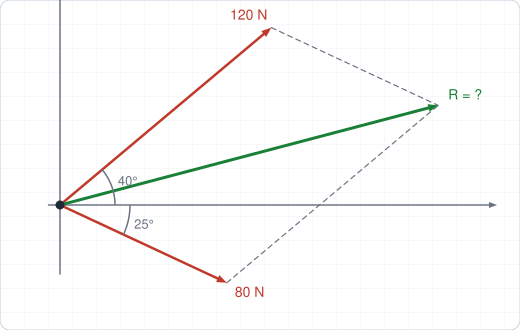

Show answer

$R_x = 120\cos 40^\circ + 80\cos 25^\circ = 164.4$ N, $R_y = 120\sin 40^\circ - 80\sin 25^\circ = 43.3$ N.

$R \approx 170$ N at about $14.8^\circ$ above the $+x$ axis.

**Problem 2 (2D vector addition).** Three forces act at a point: $P = 30$ N along $+x$, $Q = 40$ N along $+y$, and $S = 50$ N at $210^\circ$ measured counter-clockwise from $+x$. Find the resultant.

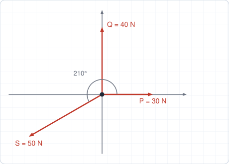

Show answer

$S_x = 50\cos 210^\circ = -43.30$ N, $S_y = 50\sin 210^\circ = -25.00$ N.

$\mathbf{R} = (30 - 43.30)\,\mathbf{i} + (40 - 25)\,\mathbf{j} = -13.3\,\mathbf{i} + 15.0\,\mathbf{j}$ N.

$R \approx 20.0$ N at $131.6^\circ$ counter-clockwise from $+x$ (that is, $48.4^\circ$ above the $-x$ axis).

**Problem 3 (2D dot product).** Find the angle between $\mathbf{A} = 6\mathbf{i} + 8\mathbf{j}$ and $\mathbf{B} = 12\mathbf{i} - 5\mathbf{j}$, and the projection of $\mathbf{A}$ onto $\mathbf{B}$.

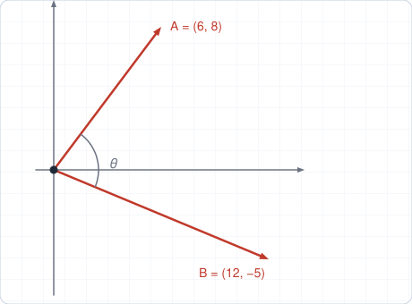

Show answer

$\mathbf{A}\cdot\mathbf{B} = 72 - 40 = 32$, $A = 10$, $B = 13$.

$\cos\theta = 32/130 = 0.2462 \Rightarrow \theta \approx 75.8^\circ$.

Projection: $A_B = 32/13 \approx 2.46$.

**Problem 4 (3D dot product).** A force $\mathbf{F} = 30\mathbf{i} - 20\mathbf{j} + 60\mathbf{k}$ N acts on a pipe whose axis has the unit vector $\mathbf{u} = \tfrac{1}{7}(2\mathbf{i} + 3\mathbf{j} + 6\mathbf{k})$. Find the component of $\mathbf{F}$ along the pipe and the angle between $\mathbf{F}$ and the pipe axis.

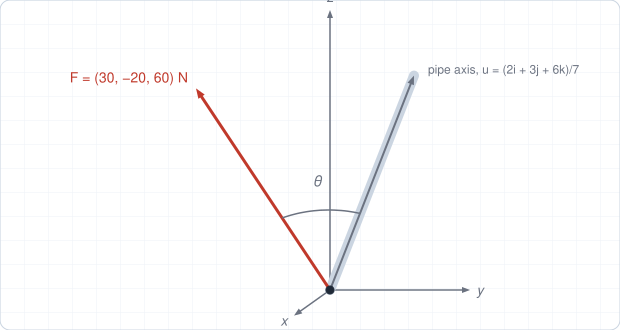

Show answer

$F_u = \mathbf{F}\cdot\mathbf{u} = \dfrac{(30)(2) + (-20)(3) + (60)(6)}{7} = \dfrac{360}{7} \approx 51.4$ N.

$F = \sqrt{30^2 + 20^2 + 60^2} = 70$ N, so $\cos\theta = 51.4/70 = 0.7347$ and $\theta \approx 42.8^\circ$.

**Problem 5 (moment by cross product).** A force $\mathbf{F} = 4\mathbf{i} - 1\mathbf{j} + 2\mathbf{k}$ kN acts at a point with position vector $\mathbf{r} = 1\mathbf{i} + 2\mathbf{j} + 3\mathbf{k}$ m from $O$. Find $\mathbf{M}_O$, its magnitude, and the moment about the $z$-axis.

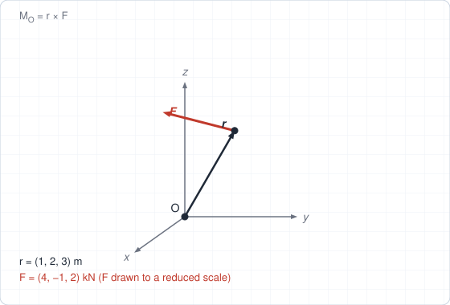

Show answer

$\mathbf{M}_O = \mathbf{r}\times\mathbf{F} = (2\cdot 2 - 3\cdot(-1))\,\mathbf{i} + (3\cdot 4 - 1\cdot 2)\,\mathbf{j} + (1\cdot(-1) - 2\cdot 4)\,\mathbf{k}$

$\mathbf{M}_O = 7\,\mathbf{i} + 10\,\mathbf{j} - 9\,\mathbf{k}$ kN·m.

$M_O = \sqrt{49 + 100 + 81} \approx 15.2$ kN·m. The moment about the $z$-axis is $M_z = -9$ kN·m.

**Problem 6 (law of cosines and sines).** Two forces of 70 N and 50 N act at a point with an angle of $110^\circ$ between them (tail to tail). Find the resultant and its angle from the 70 N force.

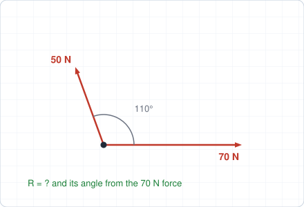

Show answer

$\gamma = 180^\circ - 110^\circ = 70^\circ$.

$R^2 = 70^2 + 50^2 + 2(70)(50)\cos 110^\circ = 7400 - 2394 = 5006 \Rightarrow R = 70.8$ N.

$\dfrac{\sin\alpha}{50} = \dfrac{\sin 70^\circ}{70.8} \Rightarrow \alpha = 41.6^\circ$ from the 70 N force, toward the 50 N force.

**Problem 7 (law of sines, two cables).** An 800 N load hangs from a ring held by cable A at $30^\circ$ and cable B at $50^\circ$ above the horizontal (on opposite sides). Find the tension in each cable.

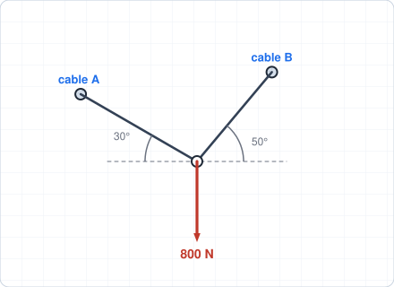

Show answer

The interior angles of the force triangle are $80^\circ$ (opposite the load), $40^\circ$ (opposite $T_A$) and $60^\circ$ (opposite $T_B$).

$T_A = \dfrac{800\sin 40^\circ}{\sin 80^\circ} = 522$ N, $\quad T_B = \dfrac{800\sin 60^\circ}{\sin 80^\circ} = 704$ N.

Check: $522\cos 30^\circ = 452$ N and $704\cos 50^\circ = 452$ N ✓.

## Self-Check

<ul style="list-style: none; padding-left: 0;">
  <li><label><input type="checkbox"> I can resolve a vector into x, y, z components.</label></li>
  <li><label><input type="checkbox"> I can add vectors using components.</label></li>
  <li><label><input type="checkbox"> I can compute a dot product and interpret the angle it gives.</label></li>
  <li><label><input type="checkbox"> I can compute a cross product and explain what it represents physically.</label></li>
  <li><label><input type="checkbox"> I can use the sine and cosine laws to solve a force triangle.</label></li>
</ul>

<Quiz chapter="ch1" />
