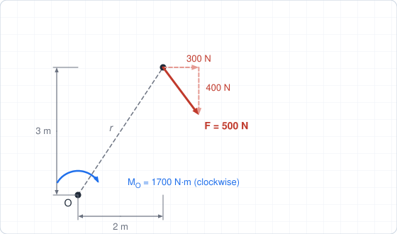
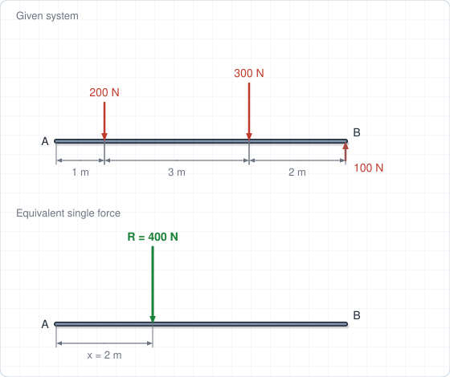
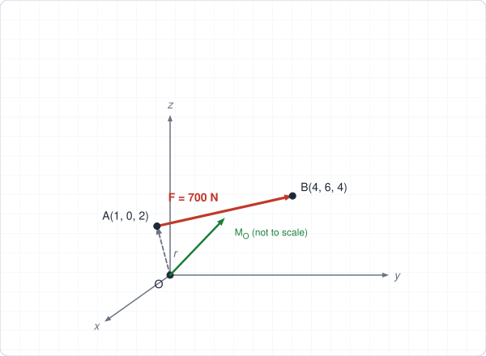
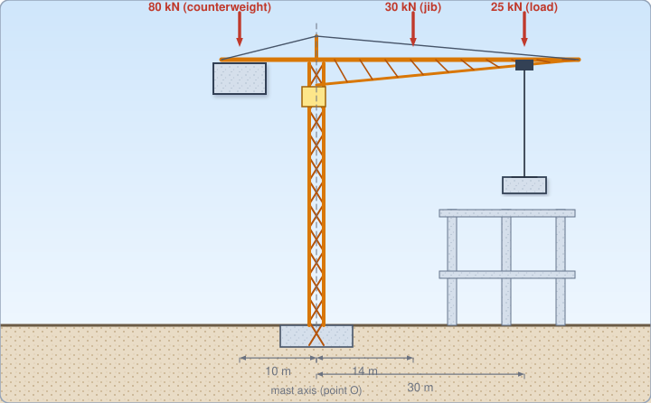

# Chapter 2 – Force Systems

**Weeks:** 3–4 | **CLO:** CLO2 | **Assessment:** Quizzes (Week 3), Test (Week 7), Group Assignment (Week 10), Final Exam

::: info Textbook Mapping
**Meriam & Kraige, 7th Ed. (SI): Chapter 2, Force Systems**

- 2/1 Introduction; 2/2 Force
- **Section A, Two-dimensional force systems:** 2/3 Rectangular Components, 2/4 Moment, 2/5 Couple, 2/6 Resultants
- **Section B, Three-dimensional force systems:** 2/7 Rectangular Components, 2/8 Moment and Couple, 2/9 Resultants

See [Textbooks](/resources/textbooks#meriam).
:::

## Learning Objectives

By the end of this chapter you should be able to:

- Resolve forces into rectangular components in 2D and 3D.
- Compute the moment of a force about a point and about an axis.
- Explain couples and replace a force by an equivalent force–couple system.
- Determine the resultant of a general 2D or 3D force system.

## Key Concepts

::: tip Real-World Application
Loads on real structures rarely act through one point. Crane jibs, retaining walls, bridge piers and building cores are checked for the moment of the loads about a support. Replacing a complicated load pattern by one equivalent force and couple is how designers pass loads down to foundations.
:::

### 2.1 Force and Its Characteristics (Meriam 2/2)

A **force** is the action of one body on another. It is a vector with a magnitude, a direction and a point of application, which together define its **line of action**.

- **Principle of transmissibility:** for a rigid body, the external effect of a force does not change if the force is moved along its line of action. A force on a rigid body is therefore a **sliding vector**.
- **Concurrent forces** have lines of action that meet at one point. They can be added by the parallelogram law, and their resultant passes through that point.
- A **free vector** (such as a couple) can be moved anywhere. A **fixed vector** has a definite point of application.

### 2.2 Two-Dimensional Rectangular Components (Meriam 2/3)

A force $\mathbf{F}$ in the $x$–$y$ plane at angle $\theta$ from the $x$-axis has components

$$
F_x = F\cos\theta, \qquad F_y = F\sin\theta, \qquad F = \sqrt{F_x^2 + F_y^2}, \qquad \theta = \tan^{-1}\frac{F_y}{F_x}
$$

If the line of action is given by a slope triangle with run $a$, rise $b$ and hypotenuse $c = \sqrt{a^2+b^2}$, then $F_x = F\,a/c$ and $F_y = F\,b/c$. No angle needs to be computed.

The resultant of concurrent forces is found by adding components:

$$
R_x = \sum F_x, \qquad R_y = \sum F_y, \qquad R = \sqrt{R_x^2 + R_y^2}
$$

### 2.3 Moment in Two Dimensions (Meriam 2/4)

The moment of a force about a point $O$ measures its tendency to rotate a body about $O$:

$$
M_O = F\,d
$$

where $d$ is the perpendicular distance from $O$ to the line of action. In 2D, counter-clockwise (CCW) is usually taken as positive. As a vector, $\mathbf{M}_O = \mathbf{r}\times\mathbf{F}$ points along the $z$-axis.

**Varignon's theorem (principle of moments):** the moment of a force equals the sum of the moments of its components. For a force acting at point $(x, y)$ relative to $O$:

$$
M_O = x\,F_y - y\,F_x
$$

This is usually faster than finding $d$ for an inclined force.

### 2.4 Couples (Meriam 2/5)

A **couple** is a pair of equal, opposite, non-collinear (parallel) forces. Its net force is zero, and its moment is the same about every point:

$$
M = F\,d
$$

A couple is a **free vector**. Couples with equal moments are equivalent. A force $\mathbf{F}$ acting at point $A$ can be replaced by the same force $\mathbf{F}$ at a new point $O$ **plus** a couple of moment $\mathbf{M} = \mathbf{r}_{OA}\times\mathbf{F}$. This is a **force–couple system**.

### 2.5 Resultants in Two Dimensions (Meriam 2/6)

Any 2D force system can be reduced to a force $\mathbf{R}$ at a chosen point $O$ plus a couple $M_O$:

$$
\mathbf{R} = \sum\mathbf{F}, \qquad M_O = \sum M_O
$$

If $\mathbf{R}\neq\mathbf{0}$, the system can be replaced by the single force $\mathbf{R}$ acting along a line that does not pass through $O$, at a perpendicular distance

$$
d = \frac{|M_O|}{R}
$$

on the side that gives $\mathbf{R}$ the correct moment sense about $O$. A convenient way to locate it is the $x$-intercept: $x\,R_y = M_O$ for a line of action cutting the $x$-axis at $x$.

### 2.6 Three-Dimensional Rectangular Components (Meriam 2/7)

$$
\mathbf{F} = F_x\mathbf{i} + F_y\mathbf{j} + F_z\mathbf{k}, \qquad F = \sqrt{F_x^2 + F_y^2 + F_z^2}
$$

$$
F_x = F\cos\theta_x, \quad F_y = F\cos\theta_y, \quad F_z = F\cos\theta_z, \qquad \cos^2\theta_x + \cos^2\theta_y + \cos^2\theta_z = 1
$$

When a force acts along the line from point $A$ to point $B$:

$$
\mathbf{F} = F\,\mathbf{n}_{AB}, \qquad \mathbf{n}_{AB} = \frac{\mathbf{r}_{AB}}{|\mathbf{r}_{AB}|} = \frac{(x_B - x_A)\mathbf{i} + (y_B - y_A)\mathbf{j} + (z_B - z_A)\mathbf{k}}{\sqrt{(x_B-x_A)^2 + (y_B-y_A)^2 + (z_B-z_A)^2}}
$$

### 2.7 Three-Dimensional Moment and Couple (Meriam 2/8)

$$
\mathbf{M}_O = \mathbf{r}\times\mathbf{F} =
\begin{vmatrix}
\mathbf{i} & \mathbf{j} & \mathbf{k} \\
x & y & z \\
F_x & F_y & F_z
\end{vmatrix}
$$

where $\mathbf{r}$ runs from $O$ to any point on the line of action of $\mathbf{F}$.

The moment of $\mathbf{F}$ about an axis through $O$ with unit direction vector $\boldsymbol{\lambda}$ is the scalar

$$
M_\lambda = \boldsymbol{\lambda}\cdot\mathbf{M}_O = \boldsymbol{\lambda}\cdot(\mathbf{r}\times\mathbf{F})
$$

The moment about the $x$-, $y$- and $z$-axes are simply the $\mathbf{i}$, $\mathbf{j}$, $\mathbf{k}$ components of $\mathbf{M}_O$. A 3D couple is the free vector $\mathbf{M} = \mathbf{r}\times\mathbf{F}$, where $\mathbf{r}$ runs between the lines of action of the two forces; couples add as vectors.

### 2.8 Three-Dimensional Resultants (Meriam 2/9)

$$
\mathbf{R} = \sum\mathbf{F}, \qquad \mathbf{M}_O = \sum(\mathbf{r}\times\mathbf{F}) + \sum\mathbf{M}_{\text{couples}}
$$

- Concurrent, coplanar and parallel force systems reduce to a **single force** (or a single couple).
- In general, $\mathbf{R}$ and $\mathbf{M}_O$ are not perpendicular. The system then reduces to a **wrench**: a force plus a couple parallel to it. The system reduces to a single force when $\mathbf{R}\cdot\mathbf{M}_O = 0$.

::: warning Common Mistakes
- Taking the moment arm as the distance to the **point of application** instead of the **perpendicular** distance to the line of action.
- Getting the **sign** of a moment wrong; choose a positive direction (usually counter-clockwise) and keep to it.
- Treating a couple as if it depends on the point about which moments are taken. A couple is a free vector.
- Using the wrong position vector in $\mathbf{r}\times\mathbf{F}$: it must run **from the moment point to the force**.
:::

## Worked Examples

### Example 2.1: Moment of an inclined force (Varignon)

A force with components $F_x = 300$ N and $F_y = -400$ N acts at a point 2 m to the right of and 3 m above $O$. Find the moment about $O$.

**Step 1: Moment of each component.** About $O$ (CCW positive):

$$
M_O = x\,F_y - y\,F_x = (2)(-400) - (3)(300) = -800 - 900 = -1700\ \text{N·m}
$$

**Step 2: Interpret.** The magnitude is 1700 N·m, **clockwise**. The force has $F = \sqrt{300^2 + 400^2} = 500$ N, so the perpendicular distance from $O$ to its line of action is

$$
d = \frac{M_O}{F} = \frac{1700}{500} = 3.4\ \text{m}
$$

$$
\boxed{M_O = 1700\ \text{N·m clockwise}}
$$

### Example 2.2: Resultant of parallel forces on a beam

A beam $AB$, 6 m long, carries three vertical forces: 200 N downward at $x = 1$ m, 300 N downward at $x = 4$ m, and 100 N upward at $x = 6$ m, where $x$ is measured from $A$. Replace the system by a single force and find where it acts.

**Step 1: Resultant force** (up positive):

$$
R_y = -200 - 300 + 100 = -400\ \text{N}
$$

**Step 2: Moment about $A$** (CCW positive):

$$
M_A = (1)(-200) + (4)(-300) + (6)(100) = -800\ \text{N·m}
$$

**Step 3: Locate the line of action.** The single force must have the same moment about $A$:

$$
x\,R_y = M_A \;\;\Rightarrow\;\; x = \frac{-800}{-400} = 2\ \text{m}
$$

$$
\boxed{\mathbf{R} = 400\ \text{N downward, acting 2 m from } A}
$$

### Example 2.3: 3D force and its moment

A force of 700 N acts along the line from $A(1, 0, 2)$ m to $B(4, 6, 4)$ m. Find the force vector, its moment about the origin $O$, and its moment about the $z$-axis.

**Step 1: Direction.**

$$
\mathbf{r}_{AB} = 3\mathbf{i} + 6\mathbf{j} + 2\mathbf{k}, \qquad |\mathbf{r}_{AB}| = \sqrt{9 + 36 + 4} = 7\ \text{m}
$$

$$
\mathbf{F} = 700\cdot\frac{3\mathbf{i} + 6\mathbf{j} + 2\mathbf{k}}{7} = 300\mathbf{i} + 600\mathbf{j} + 200\mathbf{k}\ \text{N}
$$

**Step 2: Moment about $O$.** Use $\mathbf{r} = \mathbf{r}_{OA} = 1\mathbf{i} + 0\mathbf{j} + 2\mathbf{k}$:

$$
\mathbf{M}_O = \mathbf{r}\times\mathbf{F} =
\begin{vmatrix}
\mathbf{i} & \mathbf{j} & \mathbf{k} \\
1 & 0 & 2 \\
300 & 600 & 200
\end{vmatrix}
= (0 - 1200)\mathbf{i} + (600 - 200)\mathbf{j} + (600 - 0)\mathbf{k}
$$

$$
\boxed{\mathbf{M}_O = -1200\,\mathbf{i} + 400\,\mathbf{j} + 600\,\mathbf{k}\ \text{N·m}}
$$

**Step 3: Moment about the $z$-axis** is the $\mathbf{k}$ component: $M_z = 600$ N·m.

**Check:** $\mathbf{r}\cdot\mathbf{M}_O = -1200 + 0 + 1200 = 0$ ✓, and $M_O = \sqrt{1200^2 + 400^2 + 600^2} = 1400$ N·m.

### Example 2.4 (Real-world): Overturning moment at the base of a tower crane

A tower crane has a 25 kN load at 30 m from the mast axis, a jib self-weight of 30 kN acting 14 m from the axis, and a counter-jib with counterweight totalling 80 kN acting 10 m on the other side. Find (a) the moment of the loads about the mast axis $O$, (b) the single equivalent force and where it acts, and (c) the moment when the crane is out of service with no load on the hook.

**Step 1: Moment about $O$** (counter-clockwise positive; loads on the jib side give clockwise moments):

$$
M_O = -(25)(30) - (30)(14) + (80)(10) = -750 - 420 + 800 = -370\ \text{kN·m}
$$

So $M_O = 370$ kN·m **clockwise** (the load side governs).

**Step 2: Resultant force.**

$$
R_y = -25 - 30 - 80 = -135\ \text{kN}\ (\text{downward})
$$

**Step 3: Line of action** from $x\,R_y = M_O$:

$$
x = \frac{-370}{-135} = 2.74\ \text{m on the jib side of the mast axis}
$$

$$
\boxed{\text{A single 135 kN downward force acting 2.74 m from the mast axis on the jib side}}
$$

**Step 4: (c) Out of service (no hook load).**

$$
M_O = -(30)(14) + (80)(10) = +380\ \text{kN·m (counter-clockwise)}, \qquad R_y = -110\ \text{kN}
$$

$$
x = \frac{380}{-110} = -3.45\ \text{m (on the counterweight side)}
$$

::: tip Engineering insight
The moment about the mast changes **direction** between the working and the out-of-service cases. The foundation must be checked for both, which is why designers consider more than one load case.
:::

## Tutorial Problems

Attempt each problem on paper before opening the answer. Full step-by-step solutions are in the [Chapter 2 solutions](/solutions/ch2-solutions).

**Problem 1 (2D components).** A 250 N force acts along a line that rises 5 units for every 12 units of horizontal run. Find its $x$ and $y$ components.

Show answer

The hypotenuse of the slope triangle is $\sqrt{12^2 + 5^2} = 13$.

$F_x = 250\,(12/13) = 230.8$ N, $F_y = 250\,(5/13) = 96.2$ N.

**Problem 2 (2D concurrent resultant).** Three forces act at a point: 80 N along $+x$; 60 N along $+y$; and 100 N directed down and to the left along a line with run 3 and rise 4 (that is, $(-3, -4)$ direction). Find the resultant.

Show answer

Third force: $(-3/5)(100) = -60$ N in $x$ and $(-4/5)(100) = -80$ N in $y$.

$R_x = 80 - 60 = 20$ N, $R_y = 60 - 80 = -20$ N.

$R = 28.3$ N, directed $45^\circ$ below the $+x$ axis.

**Problem 3 (2D moment).** A rigid bar 2 m long is pinned at $O$ and makes $30^\circ$ with the horizontal. A vertical downward force of 150 N acts at the free end. Find the moment about $O$.

Show answer

Perpendicular distance: $d = 2\cos 30^\circ = 1.732$ m.

$M_O = 150\,(1.732) = 259.8$ N·m, clockwise (if the bar rises to the right of $O$).

**Problem 4 (couple and force–couple system).** (a) Two parallel, opposite 80 N forces act 0.6 m apart. Find the couple. (b) A 120 N downward force acts 0.5 m to the right of $O$. Replace it by a force–couple system at $O$.

Show answer

(a) $M = Fd = 80(0.6) = 48$ N·m.

(b) The same 120 N downward force acts at $O$, plus a couple $M = 120(0.5) = 60$ N·m **clockwise**.

**Problem 5 (3D force along a line).** A 450 N force acts along the line from $A(0,0,0)$ to $B(1,2,2)$ m. Find the force vector and its direction angles.

Show answer

$|\mathbf{r}_{AB}| = 3$ m, so $\mathbf{F} = 450\,\dfrac{\mathbf{i} + 2\mathbf{j} + 2\mathbf{k}}{3} = 150\mathbf{i} + 300\mathbf{j} + 300\mathbf{k}$ N.

$\cos\theta_x = 1/3 \Rightarrow \theta_x = 70.5^\circ$, $\cos\theta_y = \cos\theta_z = 2/3 \Rightarrow \theta_y = \theta_z = 48.2^\circ$.

**Problem 6 (3D moment about an axis).** A force $\mathbf{F} = 10\mathbf{i} - 20\mathbf{j} + 5\mathbf{k}$ kN acts at a point with position vector $\mathbf{r} = 2\mathbf{i} + 1\mathbf{j} + 3\mathbf{k}$ m. Find $\mathbf{M}_O$ and the moment about the axis through $O$ with unit vector $\boldsymbol{\lambda} = \tfrac{1}{3}(\mathbf{i} + 2\mathbf{j} + 2\mathbf{k})$.

Show answer

$\mathbf{M}_O = (1\cdot 5 - 3(-20))\,\mathbf{i} + (3\cdot 10 - 2\cdot 5)\,\mathbf{j} + (2(-20) - 1\cdot 10)\,\mathbf{k} = 65\mathbf{i} + 20\mathbf{j} - 50\mathbf{k}$ kN·m.

$M_\lambda = \boldsymbol{\lambda}\cdot\mathbf{M}_O = \dfrac{65 + 40 - 100}{3} = \dfrac{5}{3} = 1.67$ kN·m.

## Self-Check

<ul style="list-style: none; padding-left: 0;">
  <li><label><input type="checkbox"> I can resolve a 2D or 3D force into rectangular components.</label></li>
  <li><label><input type="checkbox"> I can compute the moment of a force about a point, using Varignon's theorem or the cross product.</label></li>
  <li><label><input type="checkbox"> I can explain why a couple is a free vector.</label></li>
  <li><label><input type="checkbox"> I can replace a force by a force–couple system.</label></li>
  <li><label><input type="checkbox"> I can find the resultant of a 2D system and the line of action of that resultant.</label></li>
  <li><label><input type="checkbox"> I can compute the moment of a force about an axis in 3D.</label></li>
</ul>

<Quiz chapter="ch2" />
