# Chapter 3 – Equilibrium

**Weeks:** 5–6 | **CLO:** CLO3 | **Assessment:** Test (Week 7), Individual Assignment (Week 10), Group Assignment (Week 10), Final Exam

::: info Textbook Mapping
**Meriam & Kraige, 7th Ed. (SI): Chapter 3, Equilibrium**

- 3/1 Introduction
- **Section A, Equilibrium in two dimensions:** 3/2 System Isolation and the Free-Body Diagram, 3/3 Equilibrium Conditions
- **Section B, Equilibrium in three dimensions:** 3/4 Equilibrium Conditions

See [Textbooks](/resources/textbooks#meriam).
:::

## Learning Objectives

By the end of this chapter you should be able to:

- Draw complete free-body diagrams of particles and rigid bodies.
- Write and solve the equilibrium equations in 2D.
- Identify support reactions and check for statical determinacy.
- Extend the equilibrium equations to 3D problems.

## Key Concepts

::: tip Real-World Application
Support reactions are the starting point of structural design. A bridge girder, a lintel over a door and a temporary prop all transfer load to supports. A free-body diagram makes the load path visible, and the reactions it gives become the loads on abutments, columns and foundations.
:::

### 3.1 Equilibrium and the Free-Body Diagram (Meriam 3/1, 3/2)

A body is in **equilibrium** when the resultant of all forces on it is zero and the resultant moment about any point is zero. The **free-body diagram (FBD)** is the most important step in any statics problem. To draw one:

1. **Isolate** the body (or part of a structure) from its surroundings.
2. Show **all external forces** acting on it: applied loads, weight (at the center of mass), and **reactions** at every point where it touches or is attached to something else.
3. Label known forces with their values and unknowns with symbols; choose axes and show dimensions needed for moments.
4. **Do not** draw forces the body exerts on its surroundings, and do not include internal forces.

Typical 2D reactions:

| Connection | Reaction |
|---|---|
| Flexible cable, rope | One force along the cable (tension, pulling away from the body) |
| Smooth surface or roller | One force **normal** to the surface |
| Rough surface | Normal force plus friction force |
| Pin or hinge | Two force components (or one force of unknown magnitude and direction) |
| Fixed (built-in) support | Two force components **and** a couple |
| Two-force member (pin-ended, no load between) | One force along the line joining the pins |
| Spring | $F = k\delta$ along the spring |

### 3.2 Equilibrium in Two Dimensions (Meriam 3/3)

$$
\sum F_x = 0, \qquad \sum F_y = 0, \qquad \sum M_O = 0
$$

These are three independent equations, so at most **three unknowns** can be found for a body in 2D. Alternative forms are also valid: for example, two moment equations about points $A$ and $B$ plus one force equation (if the force direction is not perpendicular to line $AB$), or three moment equations about three non-collinear points.

Useful special cases:

- **Concurrent forces:** only $\sum F_x = 0$ and $\sum F_y = 0$ are needed.
- **Two-force member:** the two forces are equal, opposite and collinear.
- **Three-force member:** the three lines of action are concurrent (or all parallel).

**Statical determinacy.** If a body has *more* unknown reactions than equations, the problem is **statically indeterminate** (redundant constraints). If it has *fewer*, or the reactions are all concurrent or all parallel in the wrong way, the body is **improperly constrained** and can move.

### 3.3 Equilibrium in Three Dimensions (Meriam 3/4)

$$
\sum F_x = \sum F_y = \sum F_z = 0, \qquad \sum M_x = \sum M_y = \sum M_z = 0
$$

Six equations are available, so up to **six unknowns** can be found. In vector form: $\sum\mathbf{F} = \mathbf{0}$ and $\sum\mathbf{M}_O = \mathbf{0}$.

| Connection (3D) | Reactions |
|---|---|
| Ball-and-socket joint | 3 forces |
| Hinge (single, short) | 3 forces and 2 couples (about axes perpendicular to the hinge axis) |
| Smooth surface or cable | 1 force |
| Fixed support | 3 forces and 3 couples |

### 3.4 Solution Strategy

1. Draw a clear FBD with a coordinate system.
2. Count unknowns and equations to check determinacy.
3. Choose equations that avoid unknowns: take moments about a point where several unknown forces meet.
4. Solve, then check using an equation you did not use.
5. Interpret signs: a negative result means the force acts opposite to the assumed direction.

::: warning Common Mistakes
- Drawing an **incomplete free-body diagram**: forgetting a reaction, a weight, or a couple at a fixed support.
- Drawing forces the body exerts on its surroundings instead of the forces **on** the body.
- Assuming the direction of a reaction must be correct. A negative result just means it acts the other way.
- Taking moments about a point that does not eliminate unknowns, which makes the algebra longer than needed.
:::

## Worked Examples

### Example 3.1: Beam with an inclined load

A simply supported beam $AB$ spans 8 m. It has a pin at $A$ and a roller at $B$ (vertical reaction only). An inclined 10 kN force acts at 3 m from $A$, with components 6 kN to the right and 8 kN downward. Find the reactions.

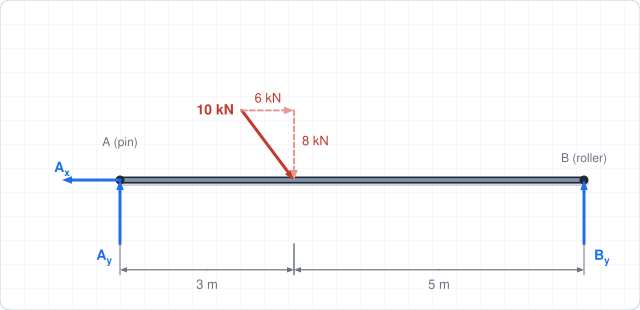

**Step 1: FBD.** Unknowns: $A_x$, $A_y$, $B_y$.

**Step 2: Moments about $A$** (eliminates $A_x$ and $A_y$; the horizontal load acts on the beam axis, so it has no moment):

$$
\sum M_A = 0:\quad B_y(8) - 8(3) = 0 \;\Rightarrow\; B_y = 3\ \text{kN}
$$

**Step 3: Forces.**

$$
\sum F_y = 0:\quad A_y + 3 - 8 = 0 \;\Rightarrow\; A_y = 5\ \text{kN}
$$

$$
\sum F_x = 0:\quad A_x + 6 = 0 \;\Rightarrow\; A_x = -6\ \text{kN}
$$

$$
\boxed{A_y = 5\ \text{kN}\uparrow,\quad A_x = 6\ \text{kN (to the left)},\quad B_y = 3\ \text{kN}\uparrow}
$$

The pin reaction has magnitude $A = \sqrt{5^2 + 6^2} = 7.81$ kN.

### Example 3.2: Bar supported by a pin and a cable

A uniform horizontal bar $AB$, 5 m long and weighing 200 N, is pinned to a wall at $A$. A cable attached at $B$ runs to the wall above and makes $30^\circ$ with the bar. A 400 N load hangs from $B$. Find the cable tension and the pin reaction at $A$.

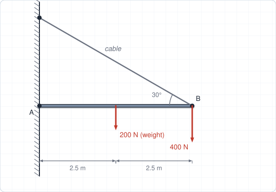

**Step 1: Moments about $A$.** Only the vertical component of the cable tension, $T\sin 30^\circ$, has a moment about $A$:

$$
\sum M_A = 0:\quad T\sin 30^\circ\,(5) - 200(2.5) - 400(5) = 0
$$

$$
2.5\,T = 2500 \;\Rightarrow\; T = 1000\ \text{N}
$$

**Step 2: Forces.**

$$
\sum F_x = 0:\quad A_x - T\cos 30^\circ = 0 \;\Rightarrow\; A_x = 866\ \text{N (away from the wall)}
$$

$$
\sum F_y = 0:\quad A_y + T\sin 30^\circ - 200 - 400 = 0 \;\Rightarrow\; A_y = 100\ \text{N}\uparrow
$$

$$
\boxed{T = 1000\ \text{N}, \qquad A = \sqrt{866^2 + 100^2} = 872\ \text{N}}
$$

### Example 3.3: Particle in 3D equilibrium (three cables)

A 1040 N load hangs from joint $D$ at the origin. Three cables run from $D$ to ceiling points with direction vectors $\overrightarrow{DA} = (2, 3, 6)$ m, $\overrightarrow{DB} = (2, -3, 6)$ m and $\overrightarrow{DC} = (-3, 0, 4)$ m, with $z$ vertical (up). Find the tensions.

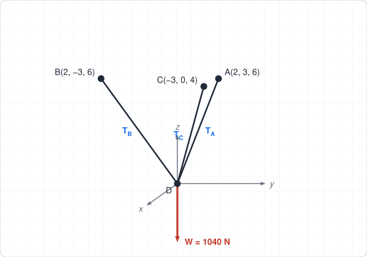

**Step 1: Unit vectors.** $|DA| = |DB| = 7$ m and $|DC| = 5$ m.

**Step 2: Equilibrium equations** ($T_A$, $T_B$, $T_C$ unknown):

$$
\sum F_x:\quad \tfrac{2}{7}T_A + \tfrac{2}{7}T_B - \tfrac{3}{5}T_C = 0
$$

$$
\sum F_y:\quad \tfrac{3}{7}T_A - \tfrac{3}{7}T_B = 0 \;\Rightarrow\; T_A = T_B = T
$$

$$
\sum F_z:\quad \tfrac{6}{7}T_A + \tfrac{6}{7}T_B + \tfrac{4}{5}T_C - 1040 = 0
$$

**Step 3: Solve.** From $\sum F_x$: $T_C = \tfrac{20}{21}T$. Substituting into $\sum F_z$:

$$
\tfrac{12}{7}T + \tfrac{4}{5}\cdot\tfrac{20}{21}T = \tfrac{52}{21}T = 1040 \;\Rightarrow\; T = 420\ \text{N}
$$

$$
\boxed{T_A = T_B = 420\ \text{N}, \qquad T_C = 400\ \text{N}}
$$

### Example 3.4 (Real-world): Reactions of a footbridge girder

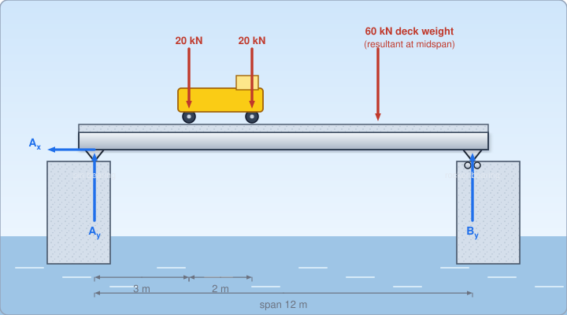

A footbridge girder spans 12 m between two abutments. One bearing is a pin (A) and the other is a rocker (B) that allows thermal movement. The deck weighs 60 kN (acting at mid-span), and a maintenance cart has two wheel loads of 20 kN each at 3 m and 5 m from A. A braking force of 8 kN acts to the right along the deck level. Find the bearing reactions.

**Step 1: Idealize and draw the FBD.** The rocker is a roller (vertical force only). Unknowns: $A_x$, $A_y$, $B_y$.

**Step 2: Moments about $A$.**

$$
\sum M_A = 0:\quad B_y(12) - 20(3) - 20(5) - 60(6) = 0 \;\Rightarrow\; B_y = \frac{520}{12} = 43.3\ \text{kN}
$$

**Step 3: Force equilibrium.**

$$
\sum F_y = 0:\quad A_y + 43.3 - 20 - 20 - 60 = 0 \;\Rightarrow\; A_y = 56.7\ \text{kN}
$$

$$
\sum F_x = 0:\quad A_x + 8 = 0 \;\Rightarrow\; A_x = -8\ \text{kN (8 kN to the left)}
$$

$$
\boxed{A_y = 56.7\ \text{kN}\uparrow,\quad A_x = 8\ \text{kN}\leftarrow,\quad B_y = 43.3\ \text{kN}\uparrow}
$$

**Check:** $A_y + B_y = 100$ kN equals the total vertical load ✓.

::: tip Engineering insight
Only one bearing carries the horizontal force. If both ends were pinned, the girder would resist thermal expansion and the system would be statically indeterminate, creating large internal forces.
:::

## Tutorial Problems

Attempt each problem on paper before opening the answer. Full step-by-step solutions are in the [Chapter 3 solutions](/solutions/ch3-solutions).

**Problem 1 (reactions: concept).** How many unknown reaction components does each of the following supports provide in 2D: (a) a pin, (b) a roller, (c) a fixed support?

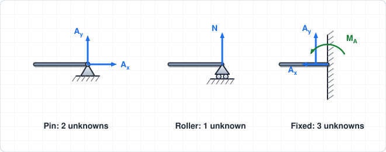

Show answer

(a) 2 (two force components). (b) 1 (a force normal to the surface). (c) 3 (two force components and a couple).

**Problem 2 (beam reactions).** A 6 m simply supported beam (pin at $A$, roller at $B$) carries a 10 kN downward load 2 m from $A$ and a 20 kN downward load 5 m from $A$. Neglect the beam's weight. Find the reactions.

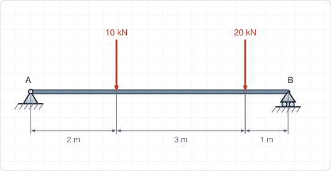

Show answer

$\sum M_A = 0$: $6B_y = 10(2) + 20(5) = 120 \Rightarrow B_y = 20$ kN.

$\sum F_y = 0$: $A_y = 30 - 20 = 10$ kN. $A_x = 0$.

**Problem 3 (particle, 2D).** A 500 N weight hangs at a joint $A$ from a cable $AB$ at $60^\circ$ above the horizontal, and is held by a horizontal cable $AC$. Find both tensions.

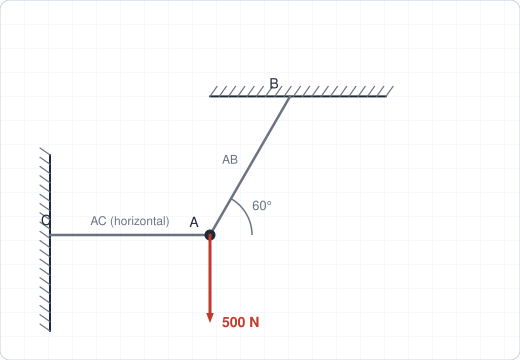

Show answer

Vertical: $T_{AB}\sin 60^\circ = 500 \Rightarrow T_{AB} = 577$ N.

Horizontal: $T_{AC} = T_{AB}\cos 60^\circ = 289$ N.

**Problem 4 (cantilever).** A cantilever beam 3 m long is built into a wall at $A$. A 4 kN downward load acts at the free end. Find the reactions at $A$.

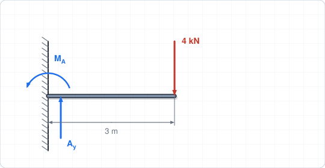

Show answer

$A_y = 4$ kN upward, $A_x = 0$.

The load gives a clockwise moment of $4(3) = 12$ kN·m about $A$, so the fixed support provides a **counter-clockwise** couple $M_A = 12$ kN·m.

**Problem 5 (3D, concept).** For a rigid body in 3D, how many independent equilibrium equations are available? How many reaction components does a ball-and-socket joint provide? A fixed support?

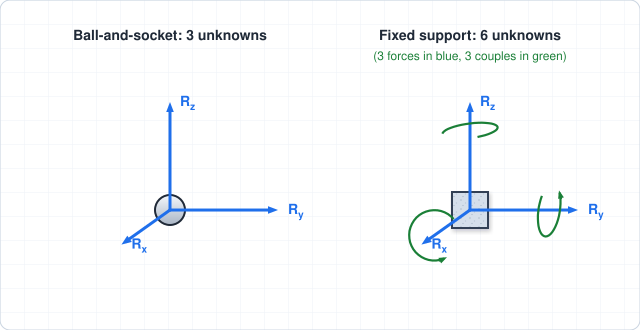

Show answer

Six equations (three force, three moment). A ball-and-socket provides 3 force components. A fixed support provides 6 (3 forces and 3 couples).

**Problem 6 (spring).** A block weighing 60 N hangs at rest from a spring of stiffness $k = 2$ kN/m. Find the spring's extension.

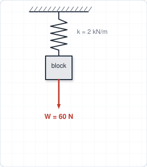

Show answer

Equilibrium: $k\delta = W$, so $\delta = 60/2000 = 0.03$ m $= 30$ mm.

**Problem 7 (determinacy).** A horizontal beam is held by a pin at $A$, a roller at $B$ and a second roller at $C$. Is it statically determinate?

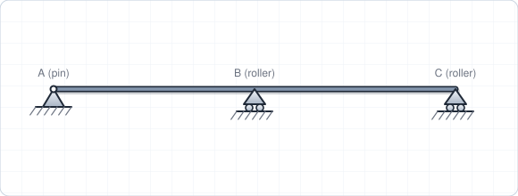

Show answer

Unknowns: 2 (pin) + 1 + 1 = 4. Equations available: 3. The beam is **statically indeterminate** (one redundant reaction).

## Self-Check

<ul style="list-style: none; padding-left: 0;">
  <li><label><input type="checkbox"> I can draw a complete free-body diagram, including all reactions.</label></li>
  <li><label><input type="checkbox"> I can write the 2D equilibrium equations and choose a point that eliminates unknowns.</label></li>
  <li><label><input type="checkbox"> I can recognize two-force and three-force members.</label></li>
  <li><label><input type="checkbox"> I can tell whether a support arrangement is statically determinate.</label></li>
  <li><label><input type="checkbox"> I can write and solve the six 3D equilibrium equations for a particle or rigid body.</label></li>
</ul>

<Quiz chapter="ch3" />
