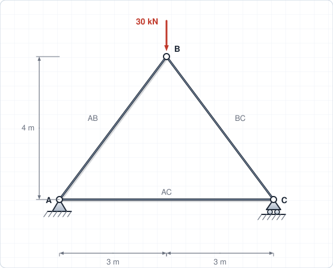
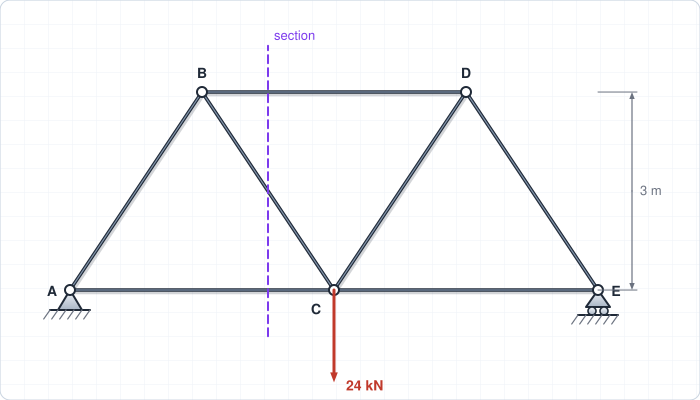
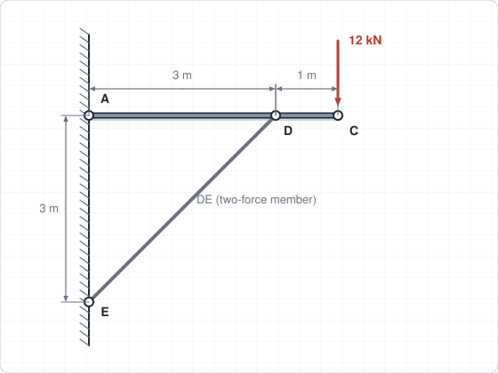
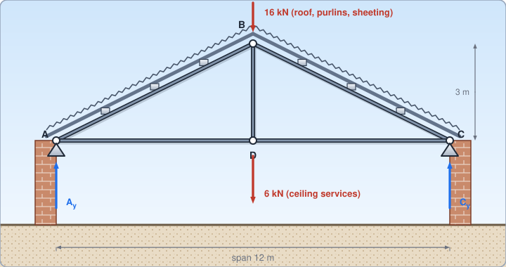
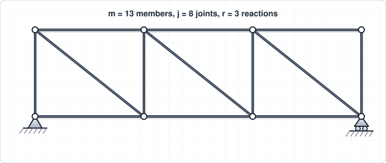
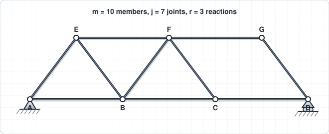
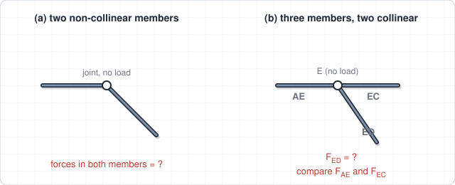
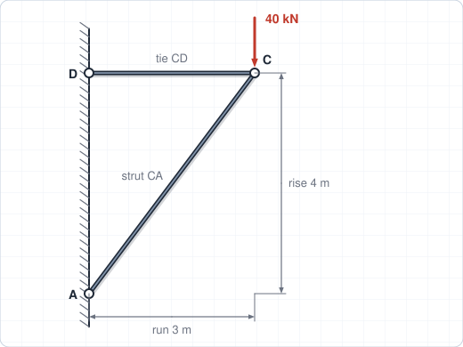
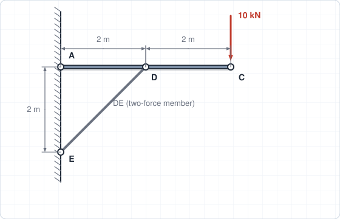
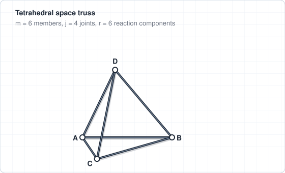

# Chapter 4 – Analysis of Simple Structures

**Weeks:** 7–9 | **CLO:** CLO4 | **Assessment:** Individual Assignment (Week 10), Final Exam

::: info Textbook Mapping
**Meriam & Kraige, 7th Ed. (SI): Chapter 4, Structures**

- 4/1 Introduction; 4/2 Plane Trusses
- 4/3 Method of Joints; 4/4 Method of Sections
- 4/5 Space Trusses; 4/6 Frames and Machines

See [Textbooks](/resources/textbooks#meriam).
:::

## Learning Objectives

By the end of this chapter you should be able to:

- Classify trusses as determinate or indeterminate.
- Find member forces by the method of joints and the method of sections.
- Analyze frames and machines by dismembering them into free bodies.

## Key Concepts

::: tip Real-World Application
Roof trusses, bridge trusses, transmission towers and scaffolds are built from two-force members. Knowing which members are in tension and which are in compression tells the designer where to use ties and where to worry about buckling. The same joint and section thinking is used behind structural software, so you can check a computer result by hand.
:::

### 4.1 Plane Trusses (Meriam 4/1, 4/2)

A **truss** is a framework of slender members joined at their ends by smooth pins and loaded only at the joints. Under these assumptions every member is a **two-force member**, carrying force along its axis only: **tension (T)** if the member pulls on the joints, **compression (C)** if it pushes.

A **simple truss** is built by adding two members and one new joint to a rigid triangle. For a plane truss with $m$ members, $j$ joints and $r$ external reaction components:

$$
m + r = 2j \quad \text{(statically determinate)}
$$

If $m + r > 2j$ the truss is statically indeterminate (redundant members). If $m + r < 2j$ it is not rigid (a mechanism). This condition is necessary but not sufficient: the arrangement must also be geometrically stable.

### 4.2 Method of Joints (Meriam 4/3)

Treat each joint as a particle in equilibrium: $\sum F_x = 0$, $\sum F_y = 0$ (two equations per joint).

1. Find the support reactions from equilibrium of the whole truss (if needed).
2. Start at a joint with **no more than two unknown** member forces.
3. Assume every unknown member force is **tension** (arrow pointing away from the joint). A negative answer means compression.
4. Move to the next joint using the results already found.

**Zero-force members** (quick checks, when no load or support is at the joint):

- If **two non-collinear** members meet at a joint, both carry zero force.
- If **three** members meet, and two are collinear, the third carries zero force.

### 4.3 Method of Sections (Meriam 4/4)

Cut the truss into two parts through the members of interest and apply the three equilibrium equations to one part. Use it when only a few member forces are needed.

- Cut through **no more than three** members whose forces are unknown.
- Take moments about the point where **two** of the cut members meet; this gives the third directly.
- The method of sections and the method of joints can be combined.

### 4.4 Space Trusses (Meriam 4/5)

A basic space truss is a tetrahedron (6 members, 4 joints). Each joint is a particle in 3D with three equations. The determinacy condition is

$$
m + r = 3j
$$

### 4.5 Frames and Machines (Meriam 4/6)

A **frame** or **machine** has at least one **multiforce member** (a member with three or more forces, or a couple, acting on it). Frames are designed to support loads; machines transmit and change forces.

1. Check whether the whole structure is rigid. If so, find the **external** reactions from the FBD of the whole structure.
2. **Dismember** the structure and draw an FBD for each part. Identify **two-force members** first; their force is along the line joining their pins.
3. At a pin joining two members, the forces on the two members are **equal and opposite** (Newton's third law). Draw each consistently.
4. Write equilibrium equations for each member and solve. Use the whole-structure FBD as a check.

::: warning Common Mistakes
- Forgetting to check **determinacy** and stability before starting.
- Starting a joint with **more than two unknowns**.
- Mixing up tension and compression signs; assume tension and read the sign of the answer.
- Cutting through **more than three** unknown members in the method of sections, or forgetting a member that the cut crosses.
:::

## Worked Examples

### Example 4.1: Method of joints

A truss consists of three members $AB$, $BC$, $AC$ forming a triangle with $A(0,0)$, $C(6,0)$, $B(3,4)$ m. A 30 kN load acts downward at $B$. $A$ is a pin support and $C$ is a roller. Find the member forces.

**Step 1: Reactions.** By symmetry, $A_y = C_y = 15$ kN and $A_x = 0$.

**Step 2: Joint $A$.** Member $AB$ has direction $(3, 4)/5$. Assume tension in $AB$ and $AC$:

$$
\sum F_y = 0:\quad \tfrac{4}{5}F_{AB} + 15 = 0 \;\Rightarrow\; F_{AB} = -18.75\ \text{kN}
$$

$$
\sum F_x = 0:\quad F_{AC} + \tfrac{3}{5}F_{AB} = 0 \;\Rightarrow\; F_{AC} = +11.25\ \text{kN}
$$

**Step 3: Joint $B$ (check).** By symmetry $F_{BC} = F_{AB}$ in magnitude. Vertical equilibrium at $B$: $2\left(18.75\right)\tfrac{4}{5} = 30$ ✓.

$$
\boxed{F_{AB} = F_{BC} = 18.75\ \text{kN (C)}, \qquad F_{AC} = 11.25\ \text{kN (T)}}
$$

### Example 4.2: Method of sections

A Warren truss has bottom joints $A(0,0)$, $C(4,0)$, $E(8,0)$ and top joints $B(2,3)$, $D(6,3)$ m, with members $AB$, $BC$, $CD$, $DE$, $BD$, $AC$, $CE$. $A$ is a pin and $E$ is a roller. A 24 kN downward load acts at $C$. Find the forces in $BD$, $BC$ and $AC$.

**Step 1: Reactions.** $\sum M_E = 0$: $8A_y = 24(4) \Rightarrow A_y = 12$ kN.

**Step 2: Cut.** A vertical cut at $x = 3$ m passes through $BD$, $BC$ and $AC$ only. Take the left part (containing $A$ and $B$) and assume all three members are in tension.

**Step 3: Moments about $C$** (eliminates $BC$ and $AC$). Force $F_{BD}$ acts at $B$, 3 m above $C$ and 2 m to its left; $A_y$ acts 4 m to the left of $C$:

$$
\sum M_C = 0:\quad -12(4) - 3F_{BD} = 0 \;\Rightarrow\; F_{BD} = -16\ \text{kN}
$$

**Step 4: Moments about $B$** (eliminates $BD$ and $BC$):

$$
\sum M_B = 0:\quad -12(2) + 3F_{AC} = 0 \;\Rightarrow\; F_{AC} = +8\ \text{kN}
$$

**Step 5: Vertical equilibrium of the left part.** $BC$ has direction $(2, -3)/\sqrt{13}$ from $B$:

$$
\sum F_y = 0:\quad 12 - \tfrac{3}{\sqrt{13}}F_{BC} = 0 \;\Rightarrow\; F_{BC} = 4\sqrt{13} = +14.4\ \text{kN}
$$

$$
\boxed{F_{BD} = 16\ \text{kN (C)}, \qquad F_{BC} = 14.4\ \text{kN (T)}, \qquad F_{AC} = 8\ \text{kN (T)}}
$$

### Example 4.3: Frame with a two-force member

A horizontal beam $AC$ (4 m long) is pinned to a wall at $A$. A strut $DE$ is pinned to the beam at $D$ (3 m from $A$) and to the wall at $E$, which is 3 m below $A$. A 12 kN downward load acts at $C$. Neglect weights. Find the force in the strut and the pin reaction at $A$.

**Step 1: Recognize the two-force member.** $DE$ carries load only at its pins, so its force acts along $DE$ at $45^\circ$ (run 3, rise 3). It pushes on the beam if in compression: components $F/\sqrt{2}$ in $x$ and $y$ on the beam.

**Step 2: FBD of beam $AC$, moments about $A$:**

$$
\sum M_A = 0:\quad \frac{F}{\sqrt{2}}(3) - 12(4) = 0 \;\Rightarrow\; \frac{F}{\sqrt{2}} = 16 \;\Rightarrow\; F = 22.6\ \text{kN (compression)}
$$

**Step 3: Forces on the beam.**

$$
\sum F_x = 0:\quad A_x + 16 = 0 \;\Rightarrow\; A_x = -16\ \text{kN}
$$

$$
\sum F_y = 0:\quad A_y + 16 - 12 = 0 \;\Rightarrow\; A_y = -4\ \text{kN}
$$

$$
\boxed{F_{DE} = 22.6\ \text{kN (C)}, \qquad A = \sqrt{16^2 + 4^2} = 16.5\ \text{kN}}
$$

The pin at $A$ pushes the beam 16 kN to the left and 4 kN downward. By Newton's third law, the beam's pin at $D$ and the wall pin at $E$ feel equal and opposite forces from the strut.

### Example 4.4 (Real-world): King-post roof truss of a warehouse

A warehouse roof is carried by a king-post truss of span 12 m and rise 3 m. Joints are $A$ and $C$ (supports), apex $B$ and bottom joint $D$ at mid-span. The roof sheeting and purlins put a 16 kN vertical load on $B$, and ceiling services put a 6 kN vertical load on $D$. $A$ is a pin and $C$ a roller. Find all member forces.

**Step 1: Determinacy.** $m = 5$, $j = 4$, $r = 3$: $m + r = 8 = 2j$ ✓.

**Step 2: Reactions** (symmetry): $A_y = C_y = (16 + 6)/2 = 11$ kN, $A_x = 0$.

**Step 3: Geometry.** $AB = \sqrt{6^2 + 3^2} = 6.708$ m, so $\sin\alpha = 3/6.708 = 0.4472$ and $\cos\alpha = 0.8944$.

**Step 4: Joint $A$** (assume tension):

$$
\sum F_y = 0:\quad F_{AB}(0.4472) + 11 = 0 \;\Rightarrow\; F_{AB} = -24.6\ \text{kN}
$$

$$
\sum F_x = 0:\quad F_{AD} + F_{AB}(0.8944) = 0 \;\Rightarrow\; F_{AD} = +22.0\ \text{kN}
$$

**Step 5: Joint $D$** ($AD$ and $DC$ are horizontal and equal, $BD$ is vertical):

$$
\sum F_y = 0:\quad F_{BD} - 6 = 0 \;\Rightarrow\; F_{BD} = +6.0\ \text{kN}
$$

**Step 6: Check at joint $B$.** The two rafters push up with $2(24.6)(0.4472) = 22.0$ kN, which balances $16 + 6 = 22$ kN downward ✓.

$$
\boxed{F_{AB} = F_{BC} = 24.6\ \text{kN (C)},\quad F_{AD} = F_{DC} = 22.0\ \text{kN (T)},\quad F_{BD} = 6.0\ \text{kN (T)}}
$$

::: tip Engineering insight
The rafters are in compression, so they must be checked for buckling. The bottom chord and the king post are in tension, so their end connections matter most.
:::

## Tutorial Problems

Attempt each problem on paper before opening the answer. Full step-by-step solutions are in the [Chapter 4 solutions](/solutions/ch4-solutions).

**Problem 1 (determinacy).** A plane truss has 13 members, 8 joints and 3 support reactions. Is it statically determinate?

Show answer

$m + r = 13 + 3 = 16 = 2j = 2(8)$. The count is satisfied, so the truss is statically determinate (given a stable arrangement).

**Problem 2 (rigidity).** A plane truss has 10 members, 7 joints and 3 reactions. Is it rigid?

Show answer

$m + r = 13 < 2j = 14$. There are too few members, so the truss is **not rigid** (it is a mechanism).

**Problem 3 (zero-force members).** (a) At an unloaded joint, only two non-collinear members meet. What are their forces? (b) At an unloaded joint, three members meet: $AE$ and $EC$ are collinear, and $ED$ is not. What is $F_{ED}$, and how do $F_{AE}$ and $F_{EC}$ compare?

Show answer

(a) Both are zero-force members.

(b) $F_{ED} = 0$, and $F_{AE} = F_{EC}$ (same magnitude and the same tension or compression).

**Problem 4 (method of joints).** A bracket carries a 40 kN downward load at joint $C$. A horizontal tie $CD$ runs to a wall on the left, and a strut $CA$ rises from the wall to $C$ with run 3 and rise 4 (the strut is lower-left of $C$). Find the force in each member.

Show answer

Vertical: the strut pushes $C$ with $(4/5)F_{CA} = 40$, so $F_{CA} = 50$ kN **compression**.

Horizontal: the strut's push has an $x$-component $(3/5)(50) = 30$ kN toward the right, balanced by the tie pulling left, so $F_{CD} = 30$ kN **tension**.

**Problem 5 (method of sections).** Repeat Example 4.2 with a 36 kN load at $C$. Find $F_{BD}$, $F_{BC}$ and $F_{AC}$.

Show answer

All forces scale with the load (factor 1.5):

$F_{BD} = 24$ kN (C), $F_{BC} = 6\sqrt{13} = 21.6$ kN (T), $F_{AC} = 12$ kN (T).

**Problem 6 (frame).** Repeat Example 4.3 with the strut attached at $D$, 2 m from $A$, with $E$ 2 m below $A$ (still $45^\circ$), and a 10 kN load at $C$. Find the strut force and the pin reaction at $A$.

Show answer

$\sum M_A = 0$: $\dfrac{F}{\sqrt{2}}(2) = 10(4) \Rightarrow \dfrac{F}{\sqrt{2}} = 20$, so $F = 28.3$ kN (C).

$A_x = -20$ kN (20 kN to the left), $A_y = 10 - 20 = -10$ kN (10 kN downward). $A = 22.4$ kN.

**Problem 7 (space truss).** A tetrahedral space truss has 6 members, 4 joints and 6 support reaction components. Is it statically determinate?

Show answer

$m + r = 6 + 6 = 12 = 3j = 3(4)$. Yes, statically determinate.

## Self-Check

<ul style="list-style: none; padding-left: 0;">
  <li><label><input type="checkbox"> I can check a truss for determinacy using the condition <i>m</i> + <i>r</i> = 2<i>j</i>.</label></li>
  <li><label><input type="checkbox"> I can find member forces by the method of joints and identify zero-force members.</label></li>
  <li><label><input type="checkbox"> I can choose a section and a moment center that give one unknown at a time.</label></li>
  <li><label><input type="checkbox"> I can dismember a frame or machine and draw consistent FBDs at the pins.</label></li>
</ul>

<Quiz chapter="ch4" />
