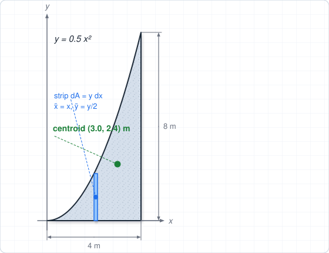
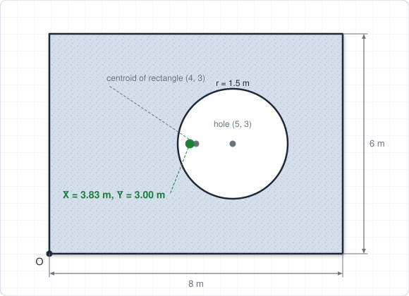
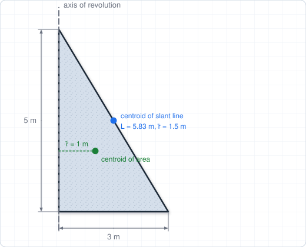
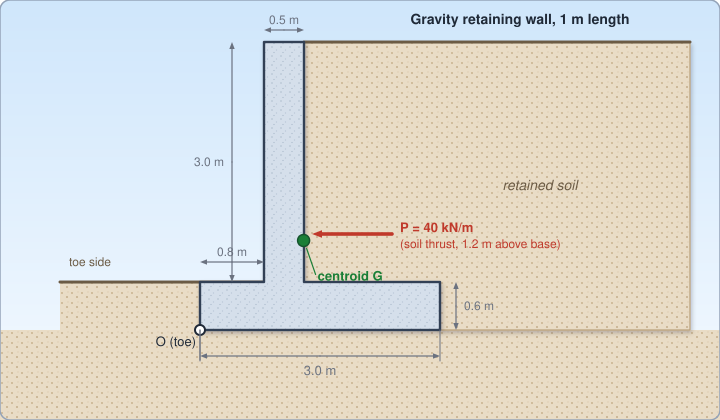
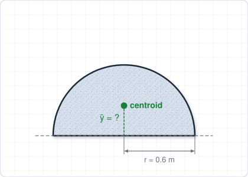
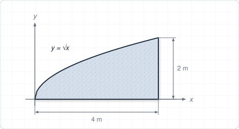
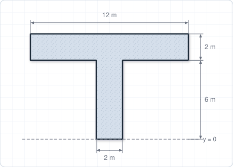
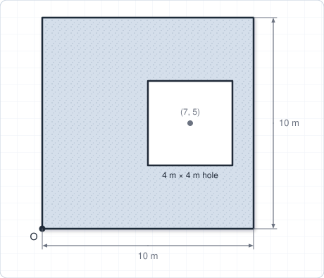
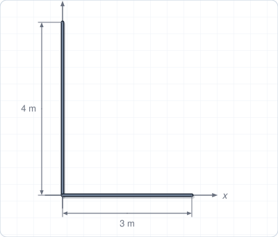
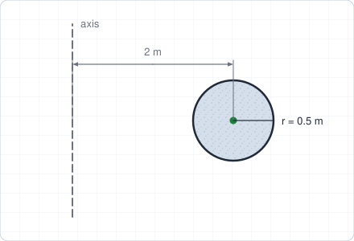

# Chapter 5 – Centroids

**Weeks:** 9–10 | **CLO:** CLO5 | **Assessment:** Individual Assignment (Week 10), Final Exam

::: info Textbook Mapping
**Meriam & Kraige, 7th Ed. (SI): Chapter 5, Distributed Forces, Sections 5/2–5/5**

- 5/2 Center of Mass; 5/3 Centroids of Lines, Areas, and Volumes
- 5/4 Composite Bodies and Figures; Approximations
- 5/5 Theorems of Pappus

See [Textbooks](/resources/textbooks#meriam).
:::

::: warning Scope
The rest of Meriam Chapter 5 (beams, flexible cables, fluid statics) is **not** covered by the course CLOs. It is linked here for reference only.
:::

## Learning Objectives

By the end of this chapter you should be able to:

- Locate the centroid of lines, areas and volumes by integration.
- Locate the centroid of composite bodies using the composite-area method.
- Apply the theorems of Pappus where appropriate.

## Key Concepts

::: tip Real-World Application
Self-weight acts through the centroid. For a retaining wall, dam, bridge pier or floor slab, the location of the centroid decides the stabilizing moment against overturning. Sections with openings, voids or ducts are handled by the same composite method, with the opening treated as negative area.
:::

### 5.1 Center of Mass, Center of Gravity and Centroid (Meriam 5/2)

For a body of total mass $m$, the **center of mass** is the point where the mass can be considered concentrated for the purpose of moments:

$$
\bar{x} = \frac{\int \tilde{x}\,dm}{m}, \qquad \bar{y} = \frac{\int \tilde{y}\,dm}{m}, \qquad \bar{z} = \frac{\int \tilde{z}\,dm}{m}
$$

where $\tilde{x}, \tilde{y}, \tilde{z}$ locate the centroid of the element $dm$. In a uniform gravitational field the **center of gravity** coincides with the center of mass. For a **homogeneous** body, the center of mass depends only on geometry and is called the **centroid**.

### 5.2 Centroids of Lines, Areas and Volumes (Meriam 5/3)

$$
\bar{x} = \frac{\int \tilde{x}\,dL}{L} \;\;\text{(lines)}, \qquad
\bar{x} = \frac{\int \tilde{x}\,dA}{A} \;\;\text{(areas)}, \qquad
\bar{x} = \frac{\int \tilde{x}\,dV}{V} \;\;\text{(volumes)}
$$

with similar equations for $\bar{y}$ and $\bar{z}$.

**Guidelines for integration.**

- Use **symmetry**: the centroid lies on any axis of symmetry.
- Choose the element to need the **fewest integrations**: a thin strip $dA = y\,dx$ (vertical) or $dA = x\,dy$ (horizontal) is a single integral.
- Always use the **centroid of the element** in the numerator. For a vertical strip $dA = y\,dx$, $\tilde{x} = x$ and $\tilde{y} = y/2$.
- Use polar elements for circular shapes.

**Standard centroids** (measured as shown in textbook tables):

| Shape | Centroid location |
|---|---|
| Rectangle ($b\times h$) | $\bar{x} = b/2$, $\bar{y} = h/2$ |
| Triangle (base $b$, height $h$) | $\bar{y} = h/3$ above the base |
| Quarter-circle area (radius $r$) | $\bar{x} = \bar{y} = \dfrac{4r}{3\pi}$ |
| Semicircular area (radius $r$) | $\bar{y} = \dfrac{4r}{3\pi}$ from the diameter |
| Semicircular arc (radius $r$) | $\bar{y} = \dfrac{2r}{\pi}$ from the diameter |
| Circular sector (half-angle $\alpha$) | $\bar{x} = \dfrac{2}{3}\dfrac{r\sin\alpha}{\alpha}$ from the vertex |
| Circular arc (half-angle $\alpha$) | $\bar{x} = \dfrac{r\sin\alpha}{\alpha}$ from the center |

### 5.3 Composite Bodies and Figures (Meriam 5/4)

Split a complicated shape into simple parts whose centroids are known:

$$
\bar{X} = \frac{\sum A_i\,\bar{x}_i}{\sum A_i}, \qquad
\bar{Y} = \frac{\sum A_i\,\bar{y}_i}{\sum A_i}
$$

The same form works for lines ($L_i$) and volumes ($V_i$). A **hole** or cut-out is treated as a part with **negative** area. A tabular layout (area, $\bar{x}_i$, $\bar{y}_i$, $A_i\bar{x}_i$, $A_i\bar{y}_i$) keeps the work organized.

### 5.4 Theorems of Pappus (Meriam 5/5)

A surface or volume of revolution is generated by rotating a plane curve or area about an axis in its plane that does not cross it. Let $\bar{r}$ be the distance from the axis to the centroid of the generating curve or area, and $\theta$ the angle of revolution (in radians; $2\pi$ for a full turn).

$$
A = \theta\,\bar{r}\,L \;\;\text{(surface area)}, \qquad V = \theta\,\bar{r}\,A_g \;\;\text{(volume)}
$$

For a full revolution, $A = 2\pi\bar{r}L$ and $V = 2\pi\bar{r}A_g$, where $L$ is the length of the generating curve and $A_g$ the generating area.

::: tip Scope
The rest of Meriam Chapter 5 (beams, flexible cables, fluid statics) is not required for this course. See Meriam Sections 5/6–5/9 only if you want to read ahead.
:::

::: warning Common Mistakes
- Using the centroid of the **whole** area in the integral instead of the centroid of the **element**.
- Forgetting to treat a hole as **negative** area.
- Measuring all $\bar{x}_i$ and $\bar{y}_i$ from **different origins** in a composite table.
- Using the Pappus formulas with the distance to the wrong axis.
:::

## Worked Examples

### Example 5.1: Centroid by integration

Find the centroid of the area under the curve $y = 0.5\,x^2$ (with $x$, $y$ in metres) between $x = 0$ and $x = 4$ m.

**Step 1: Element.** Use a vertical strip: $dA = y\,dx$, $\tilde{x} = x$, $\tilde{y} = y/2$.

**Step 2: Area.**

$$
A = \int_0^4 0.5\,x^2\,dx = 0.5\cdot\frac{64}{3} = 10.67\ \text{m}^2
$$

**Step 3: First moments.**

$$
\int\tilde{x}\,dA = \int_0^4 x(0.5\,x^2)\,dx = 0.5\cdot\frac{4^4}{4} = 32\ \text{m}^3
$$

$$
\int\tilde{y}\,dA = \int_0^4 \frac{y}{2}\,y\,dx = \frac{1}{2}\int_0^4 0.25\,x^4\,dx = 0.125\cdot\frac{4^5}{5} = 25.6\ \text{m}^3
$$

**Step 4: Centroid.**

$$
\bar{x} = \frac{32}{10.67} = 3.0\ \text{m}, \qquad \bar{y} = \frac{25.6}{10.67} = 2.4\ \text{m}
$$

$$
\boxed{(\bar{x}, \bar{y}) = (3.0,\ 2.4)\ \text{m}}
$$

### Example 5.2: Composite area with a hole

A rectangular plate 8 m by 6 m has its lower-left corner at the origin. It has a circular hole of radius 1.5 m centered at $(5, 3)$ m. Find the centroid.

| Part | $A_i$ (m$^2$) | $\bar{x}_i$ (m) | $\bar{y}_i$ (m) | $A_i\bar{x}_i$ | $A_i\bar{y}_i$ |
|---|---|---|---|---|---|
| Rectangle | 48.00 | 4 | 3 | 192.00 | 144.00 |
| Hole | $-7.07$ | 5 | 3 | $-35.34$ | $-21.21$ |
| **Total** | **40.93** | | | **156.66** | **122.79** |

$$
\bar{X} = \frac{156.66}{40.93} = 3.83\ \text{m}, \qquad \bar{Y} = \frac{122.79}{40.93} = 3.00\ \text{m}
$$

$$
\boxed{(\bar{X}, \bar{Y}) = (3.83,\ 3.00)\ \text{m}}
$$

The centroid shifts left of the rectangle's center because material was removed on the right.

### Example 5.3: Theorems of Pappus

Use the theorems of Pappus to find (a) the volume and (b) the lateral surface area of a cone of base radius 3 m and height 5 m.

**(a) Volume.** Rotate a right triangle (base 3 m, height 5 m) about its vertical leg. Generating area $A_g = \tfrac{1}{2}(3)(5) = 7.5$ m$^2$ and its centroid is $\bar{r} = 3/3 = 1$ m from the axis:

$$
V = 2\pi\bar{r}A_g = 2\pi(1)(7.5) = 47.1\ \text{m}^3
$$

This agrees with $\tfrac{1}{3}\pi r^2 h = 47.1$ m$^3$ ✓.

**(b) Lateral surface.** The generating curve is the slant line of length $L = \sqrt{3^2 + 5^2} = 5.83$ m, whose centroid is at its midpoint, $\bar{r} = 1.5$ m:

$$
A = 2\pi\bar{r}L = 2\pi(1.5)(5.83) = 55.0\ \text{m}^2
$$

This agrees with $\pi r L = 55.0$ m$^2$ ✓.

### Example 5.4 (Real-world): Stability of a gravity retaining wall

A 1 m length of concrete retaining wall has a base slab 3.0 m wide by 0.6 m thick, with the toe 0.8 m long, and a stem 0.5 m thick and 3.0 m high. Concrete weighs 24 kN/m$^3$. Soil exerts a horizontal thrust $P = 40$ kN per metre acting 1.2 m above the underside of the base. Find (a) the centroid of the section measured from the toe $O$, (b) the weight per metre and its moment about $O$, and (c) the factor of safety against overturning about $O$. Neglect the weight of soil on the heel and any resistance at the toe.

**Step 1: Composite section** (origin at the bottom of the toe $O$):

| Part | $A_i$ (m$^2$) | $\bar{x}_i$ (m) | $\bar{y}_i$ (m) | $A_i\bar{x}_i$ | $A_i\bar{y}_i$ |
|---|---|---|---|---|---|
| Base slab | $3.0 \times 0.6 = 1.80$ | 1.50 | 0.30 | 2.700 | 0.540 |
| Stem | $0.5 \times 3.0 = 1.50$ | $0.8 + 0.25 = 1.05$ | $0.6 + 1.5 = 2.10$ | 1.575 | 3.150 |
| **Total** | **3.30** | | | **4.275** | **3.690** |

$$
\bar{X} = \frac{4.275}{3.30} = 1.30\ \text{m}, \qquad \bar{Y} = \frac{3.690}{3.30} = 1.12\ \text{m}
$$

**Step 2: Weight and stabilizing moment.**

$$
W = 24(3.30) = 79.2\ \text{kN/m}, \qquad M_R = W\bar{X} = 79.2(1.2955) = 102.6\ \text{kN·m/m}
$$

**Step 3: Overturning moment and factor of safety.**

$$
M_O = P(1.2) = 40(1.2) = 48\ \text{kN·m/m}, \qquad FS = \frac{M_R}{M_O} = \frac{102.6}{48} = 2.14
$$

$$
\boxed{\bar{X} = 1.30\ \text{m},\quad W = 79.2\ \text{kN/m},\quad FS_{\text{overturning}} \approx 2.1}
$$

::: tip Engineering insight
Required factors of safety depend on the design code (values of about 1.5 to 2.0 are common); check the code used in your country. Neglecting the soil on the heel is conservative, because that soil actually adds to the stabilizing moment.
:::

## Tutorial Problems

Attempt each problem on paper before opening the answer. Full step-by-step solutions are in the [Chapter 5 solutions](/solutions/ch5-solutions).

**Problem 1 (standard shape).** Find the distance from the diameter to the centroid of a semicircular plate of radius 0.6 m.

Show answer

$\bar{y} = \dfrac{4r}{3\pi} = \dfrac{4(0.6)}{3\pi} = 0.255$ m.

**Problem 2 (integration).** Find the centroid of the area under $y = \sqrt{x}$ for $0 \le x \le 4$ m.

Show answer

$A = \int_0^4 x^{1/2}dx = \tfrac{16}{3}$ m$^2$.

$\bar{x} = \dfrac{\int_0^4 x^{3/2}dx}{A} = \dfrac{64/5}{16/3} = 2.4$ m.

$\bar{y} = \dfrac{\tfrac{1}{2}\int_0^4 x\,dx}{A} = \dfrac{4}{16/3} = 0.75$ m.

**Problem 3 (composite area).** A T-shaped area has a flange 12 m wide by 2 m tall on top of a web 2 m wide by 6 m tall, centered under the flange. Take the bottom of the web as $y = 0$. Find $\bar{Y}$.

Show answer

Web: $A = 12$, $\bar{y} = 3$. Flange: $A = 24$, $\bar{y} = 7$.

$\bar{Y} = \dfrac{12(3) + 24(7)}{36} = \dfrac{204}{36} = 5.67$ m. By symmetry $\bar{X}$ is on the vertical centerline (6 m from either edge).

**Problem 4 (composite with a hole).** A 10 m by 10 m square plate (lower-left corner at the origin) has a 4 m by 4 m square hole centered at $(7, 5)$ m. Find the centroid.

Show answer

$A = 100 - 16 = 84$ m$^2$.

$\bar{X} = \dfrac{100(5) - 16(7)}{84} = \dfrac{388}{84} = 4.62$ m, $\bar{Y} = 5.00$ m.

**Problem 5 (composite line).** A thin wire is bent into an L shape: a 3 m segment along $+x$ from the origin and a 4 m segment along $+y$ from the origin. Find the centroid of the wire.

Show answer

$L_1 = 3$ at $(1.5, 0)$; $L_2 = 4$ at $(0, 2)$.

$\bar{X} = \dfrac{3(1.5) + 0}{7} = 0.643$ m, $\bar{Y} = \dfrac{0 + 4(2)}{7} = 1.143$ m.

**Problem 6 (Pappus).** A solid ring (torus) is formed by revolving a circle of radius 0.5 m about an axis in its plane, 2 m from the circle's center. Find its volume.

Show answer

$V = 2\pi\bar{r}A_g = 2\pi(2)(\pi\times 0.5^2) = 9.87$ m$^3$.

## Self-Check

<ul style="list-style: none; padding-left: 0;">
  <li><label><input type="checkbox"> I can explain the difference between center of mass, center of gravity and centroid.</label></li>
  <li><label><input type="checkbox"> I can set up and evaluate the integrals for the centroid of an area bounded by a curve.</label></li>
  <li><label><input type="checkbox"> I can find the centroid of a composite area, including holes.</label></li>
  <li><label><input type="checkbox"> I can apply the theorems of Pappus to areas and volumes of revolution.</label></li>
</ul>

<Quiz chapter="ch5" />
