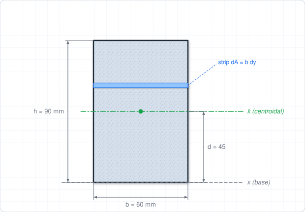
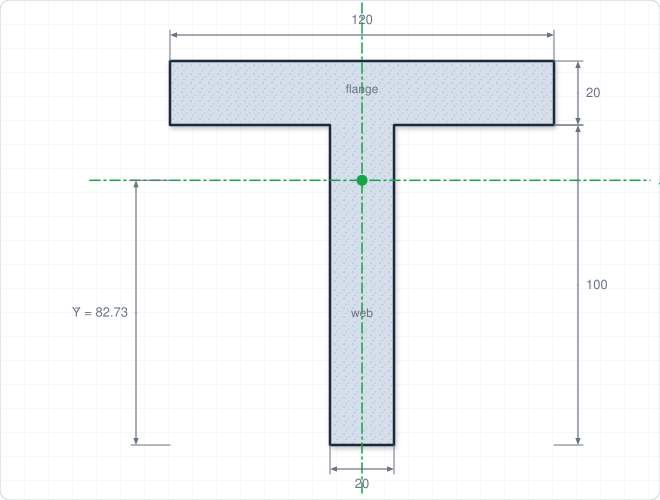
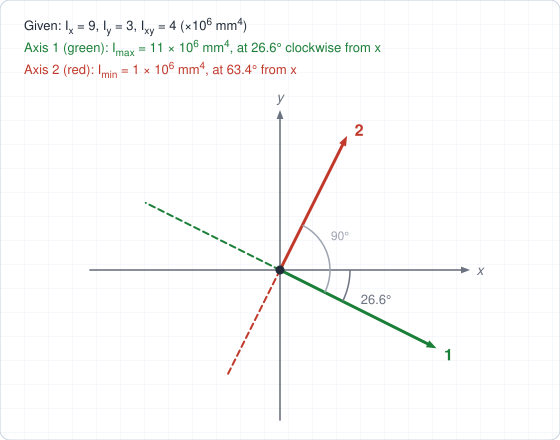
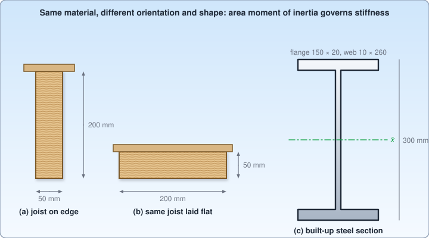

# Chapter 6 – Area Moments of Inertia

**Weeks:** 11–12 | **CLO:** CLO5 | **Assessment:** Final Exam

::: info Textbook Mapping
**Meriam & Kraige, 7th Ed. (SI): APPENDIX A, Area Moments of Inertia, Sections A/1–A/4**

- A/1 Introduction; A/2 Definitions
- A/3 Composite Areas
- A/4 Products of Inertia and Rotation of Axes

See [Textbooks](/resources/textbooks#meriam).
:::

::: warning Appendix, not a main chapter
In Meriam 7th Ed., area moments of inertia are in **Appendix A**, not in a numbered chapter. Look in the back of the book.
:::

## Learning Objectives

By the end of this chapter you should be able to:

- Compute area moments of inertia by integration.
- Apply the parallel-axis theorem and the composite-area method.
- Compute the radius of gyration and the product of inertia.

## Key Concepts

::: tip Real-World Application
The area moment of inertia controls how stiff a section is when a member bends or buckles. It is why floor joists are placed on edge, why steel beams are I-shaped and why deeper sections are used for longer spans. You will use these values directly in Strength of Materials and Structural Analysis.
:::

### 6.1 Definitions (Meriam A/1, A/2)

The **area moment of inertia** measures how an area is distributed relative to an axis. It governs the bending stiffness of beams and the buckling of columns, and it appears in many later courses.

For an area $A$ in the $x$–$y$ plane:

$$
I_x = \int y^2\,dA, \qquad I_y = \int x^2\,dA
$$

The **polar moment of inertia** about the origin (the $z$-axis) is

$$
J_O = \int r^2\,dA = I_x + I_y
$$

The **radius of gyration** is the distance at which the whole area could be concentrated to give the same moment of inertia:

$$
k_x = \sqrt{\frac{I_x}{A}}, \qquad k_y = \sqrt{\frac{I_y}{A}}
$$

Moments of inertia are always **positive** and have units of length$^4$ (for example m$^4$ or mm$^4$).

**Evaluation by integration.** Choose a strip that is parallel to the axis whenever possible, so that every point of the element is at the same distance from the axis. For a rectangle of width $b$ and height $h$ with the base on the $x$-axis, a strip $dA = b\,dy$ at height $y$ gives

$$
I_x = \int_0^h y^2\,b\,dy = \frac{b\,h^3}{3}
$$

### 6.2 Standard Results

| Shape | Axis | Moment of inertia |
|---|---|---|
| Rectangle ($b\times h$) | Centroidal, parallel to base | $\bar{I} = \dfrac{bh^3}{12}$ |
| Rectangle | About the base | $I = \dfrac{bh^3}{3}$ |
| Triangle (base $b$, height $h$) | Centroidal, parallel to base | $\bar{I} = \dfrac{bh^3}{36}$ |
| Triangle | About the base | $I = \dfrac{bh^3}{12}$ |
| Circle (radius $r$) | Any diameter | $\bar{I} = \dfrac{\pi r^4}{4}$ |
| Circle | Polar, about center | $J = \dfrac{\pi r^4}{2}$ |
| Semicircle | About the diameter | $I = \dfrac{\pi r^4}{8}$ |
| Quarter circle | About either straight edge | $I = \dfrac{\pi r^4}{16}$ |

### 6.3 Parallel-Axis Theorem and Composite Areas (Meriam A/3)

The moment of inertia about any axis is related to that about the **parallel centroidal axis** by

$$
I = \bar{I} + A\,d^2
$$

where $d$ is the distance between the two axes. The theorem **must** start from (or end at) the centroidal axis. To go between two non-centroidal axes, transfer through the centroid.

For **composite areas**: split into simple shapes, compute each part's $I_i = \bar{I}_i + A_id_i^2$ about the common axis, and add them. A hole is subtracted. Always locate the **centroid of the whole area first**, then compute $d_i$ from that centroid.

### 6.4 Products of Inertia and Rotation of Axes (Meriam A/4)

The **product of inertia** is

$$
I_{xy} = \int xy\,dA
$$

It can be positive, negative or zero. It is zero if either axis is an axis of symmetry. The parallel-axis theorem for products is

$$
I_{xy} = \bar{I}_{xy} + A\,d_x\,d_y
$$

where $d_x$ and $d_y$ are the signed coordinates of the centroid relative to the new axes.

**Rotation of axes.** For axes $x'$–$y'$ rotated by angle $\alpha$ (CCW) from $x$–$y$:

$$
I_{x'} = \frac{I_x + I_y}{2} + \frac{I_x - I_y}{2}\cos 2\alpha - I_{xy}\sin 2\alpha
$$

$$
I_{x'y'} = \frac{I_x - I_y}{2}\sin 2\alpha + I_{xy}\cos 2\alpha
$$

**Principal axes** are the axes for which the product of inertia is zero. They give the maximum and minimum moments of inertia:

$$
\tan 2\alpha_p = \frac{-2I_{xy}}{I_x - I_y}, \qquad
I_{\max,\min} = \frac{I_x + I_y}{2} \pm \sqrt{\left(\frac{I_x - I_y}{2}\right)^2 + I_{xy}^2}
$$

::: warning Common Mistakes
- Using the parallel-axis theorem **between two non-centroidal axes**. It must go through the centroidal axis.
- Adding the moments of inertia of parts about **different axes**.
- Using $bh^3/12$ with $b$ and $h$ swapped, or with the axis rotated.
- Forgetting to **subtract** the moment of inertia of a hole.
:::

## Worked Examples

### Example 6.1: Rectangle by integration, then the parallel-axis theorem

Find $I_x$ about the base and about the centroidal axis for a rectangle of width $b = 60$ mm and height $h = 90$ mm.

**Step 1: About the base** (integration shown in Section 6.1):

$$
I_{\text{base}} = \frac{bh^3}{3} = \frac{(60)(90)^3}{3} = 14.58\times 10^{6}\ \text{mm}^4
$$

**Step 2: Transfer to the centroid.** $A = 5400$ mm$^2$ and $d = h/2 = 45$ mm:

$$
\bar{I} = I_{\text{base}} - A\,d^2 = 14.58\times 10^{6} - (5400)(45)^2 = 3.645\times 10^{6}\ \text{mm}^4
$$

$$
\boxed{\bar{I} = \frac{bh^3}{12} = 3.645\times 10^{6}\ \text{mm}^4}
$$

### Example 6.2: Composite T-section

A T-section has a flange 120 mm wide by 20 mm thick on top of a web 20 mm wide by 100 mm tall (total height 120 mm). Find the centroidal moments of inertia $\bar{I}_x$ and $\bar{I}_y$.

**Step 1: Centroid** (measured up from the bottom of the web):

| Part | $A_i$ (mm$^2$) | $y_i$ (mm) | $A_iy_i$ |
|---|---|---|---|
| Web | 2000 | 50 | 100 000 |
| Flange | 2400 | 110 | 264 000 |
| **Total** | **4400** | | **364 000** |

$$
\bar{Y} = \frac{364\,000}{4400} = 82.73\ \text{mm}
$$

**Step 2: $\bar{I}_x$ about the centroidal axis.** Web: $d = 82.73 - 50 = 32.73$ mm. Flange: $d = 110 - 82.73 = 27.27$ mm.

$$
I_{\text{web}} = \frac{20(100)^3}{12} + 2000(32.73)^2 = 1.667\times 10^6 + 2.142\times 10^6 = 3.809\times 10^6\ \text{mm}^4
$$

$$
I_{\text{flange}} = \frac{120(20)^3}{12} + 2400(27.27)^2 = 0.080\times 10^6 + 1.785\times 10^6 = 1.865\times 10^6\ \text{mm}^4
$$

$$
\boxed{\bar{I}_x = 5.67\times 10^{6}\ \text{mm}^4}
$$

**Step 3: $\bar{I}_y$** (vertical axis of symmetry; both parts are centered, so $d = 0$):

$$
\bar{I}_y = \frac{100(20)^3}{12} + \frac{20(120)^3}{12} = 0.067\times 10^6 + 2.880\times 10^6 = 2.95\times 10^{6}\ \text{mm}^4
$$

### Example 6.3: Principal moments of inertia

For a certain area, $I_x = 9\times 10^6$ mm$^4$, $I_y = 3\times 10^6$ mm$^4$ and $I_{xy} = 4\times 10^6$ mm$^4$. Find the principal moments and the orientation of the principal axes.

**Step 1: Principal values** (in units of $10^6$ mm$^4$):

$$
\frac{I_x + I_y}{2} = 6, \qquad \frac{I_x - I_y}{2} = 3, \qquad \sqrt{3^2 + 4^2} = 5
$$

$$
I_{\max} = 6 + 5 = 11, \qquad I_{\min} = 6 - 5 = 1
$$

**Step 2: Orientation.**

$$
\tan 2\alpha_p = \frac{-2(4)}{9 - 3} = -1.333 \;\Rightarrow\; 2\alpha_p = -53.1^\circ \;\Rightarrow\; \alpha_p = -26.6^\circ
$$

**Step 3: Which axis is which?** At $\alpha = -26.6^\circ$:

$$
I_{x'} = 6 + 3\cos(-53.1^\circ) - 4\sin(-53.1^\circ) = 6 + 1.8 + 3.2 = 11
$$

$$
\boxed{I_{\max} = 11\times 10^6\ \text{mm}^4\ \text{at } 26.6^\circ\ \text{clockwise from } x;\quad I_{\min} = 1\times 10^6\ \text{mm}^4\ \text{at } 63.4^\circ}
$$

### Example 6.4 (Real-world): Floor joists and a built-up steel girder section

(a) A timber floor joist is 50 mm wide and 200 mm deep. Compare $\bar{I}_x$ when it is placed on edge and when it is laid flat. (b) A built-up steel girder has two flange plates 150 mm × 20 mm and a web plate 10 mm × 260 mm (total depth 300 mm). Find $\bar{I}_x$, the area and the radius of gyration about the horizontal centroidal axis.

**Step 1: (a) Joist on edge** ($b = 50$, $h = 200$):

$$
\bar{I}_{\text{edge}} = \frac{50(200)^3}{12} = 33.3\times 10^{6}\ \text{mm}^4
$$

**Joist laid flat** ($b = 200$, $h = 50$):

$$
\bar{I}_{\text{flat}} = \frac{200(50)^3}{12} = 2.08\times 10^{6}\ \text{mm}^4
$$

$$
\frac{\bar{I}_{\text{edge}}}{\bar{I}_{\text{flat}}} = 16
$$

**Step 2: (b) Girder section** (bounding rectangle minus the two side voids, each $\tfrac{150 - 10}{2} = 70$ mm wide, together 140 mm wide and 260 mm tall):

$$
\bar{I}_x = \frac{150(300)^3 - 140(260)^3}{12} = \frac{4.05\times 10^{9} - 2.461\times 10^{9}}{12} = 132.4\times 10^{6}\ \text{mm}^4
$$

**Check with the parallel-axis theorem.** Each flange: $\bar{I} = \frac{150(20)^3}{12} = 0.1\times 10^6$ and $d = 140$ mm, so $I = 0.1\times 10^6 + 3000(140)^2 = 58.9\times 10^6$ mm$^4$. Web: $\frac{10(260)^3}{12} = 14.6\times 10^6$ mm$^4$. Total $= 2(58.9) + 14.6 = 132.4\times 10^6$ mm$^4$ ✓.

**Step 3: Area and radius of gyration.**

$$
A = 2(150)(20) + 10(260) = 8600\ \text{mm}^2, \qquad k_x = \sqrt{\frac{132.4\times 10^{6}}{8600}} = 124\ \text{mm}
$$

$$
\boxed{\bar{I}_x = 132\times 10^{6}\ \text{mm}^4,\quad A = 8600\ \text{mm}^2,\quad k_x = 124\ \text{mm}}
$$

::: tip Engineering insight
A joist on edge is 16 times stiffer in bending than the same joist laid flat, with no extra material. Later you will see that deflection is inversely proportional to $I$.
:::

## Tutorial Problems

Attempt each problem on paper before opening the answer. Full step-by-step solutions are in the [Chapter 6 solutions](/solutions/ch6-solutions).

**Problem 1 (circle).** Find $I$ about a diameter and the polar moment $J$ for a circle of radius 50 mm.

Show answer

$I = \dfrac{\pi r^4}{4} = \dfrac{\pi(50)^4}{4} = 4.91\times 10^6$ mm$^4$.

$J = \dfrac{\pi r^4}{2} = 9.82\times 10^6$ mm$^4$.

**Problem 2 (triangle).** A triangle has base 120 mm and height 90 mm. Find $I$ about its base and about the parallel centroidal axis.

Show answer

About the base: $I = \dfrac{bh^3}{12} = \dfrac{120(90)^3}{12} = 7.29\times 10^6$ mm$^4$.

Centroidal: $\bar{I} = \dfrac{bh^3}{36} = 2.43\times 10^6$ mm$^4$.

Check: $7.29\times 10^6 - \tfrac{1}{2}(120)(90)(30)^2 = 7.29\times 10^6 - 4.86\times 10^6 = 2.43\times 10^6$ ✓.

**Problem 3 (hollow section).** A hollow rectangular section has outer dimensions 200 mm wide by 300 mm tall and an inner (hollow) rectangle 120 mm wide by 220 mm tall, centered. Find $\bar{I}_x$.

Show answer

$\bar{I}_x = \dfrac{200(300)^3 - 120(220)^3}{12} = \dfrac{5.4\times 10^9 - 1.278\times 10^9}{12} = 3.44\times 10^{8}$ mm$^4$.

**Problem 4 (radius of gyration).** Find the radius of gyration about the centroidal horizontal axis of a rectangle 100 mm wide by 200 mm tall.

Show answer

$\bar{I} = \dfrac{100(200)^3}{12} = 6.67\times 10^7$ mm$^4$, $A = 20\,000$ mm$^2$.

$k = \sqrt{\bar{I}/A} = \sqrt{3333} = 57.7$ mm (equal to $h/\sqrt{12}$).

**Problem 5 (I-section).** An I-section has two flanges, each 100 mm wide by 20 mm thick, and a web 20 mm thick between them. The total height is 200 mm, so the web is 160 mm tall. Find $\bar{I}_x$ about the horizontal centroidal axis.

Show answer

Treat as a 100 × 200 rectangle minus two 40 × 160 rectangles (one on each side of the web, 80 mm total):

$\bar{I}_x = \dfrac{100(200)^3 - 80(160)^3}{12} = \dfrac{8\times 10^8 - 3.277\times 10^8}{12} = 3.94\times 10^{7}$ mm$^4$.

**Problem 6 (product of inertia).** A rectangle 60 mm wide by 40 mm tall has its lower-left corner at the origin. Find $I_{xy}$ about the $x$–$y$ axes through that corner.

Show answer

The centroidal $\bar{I}_{xy} = 0$ (symmetry). The centroid is at $(30, 20)$ mm and $A = 2400$ mm$^2$.

$I_{xy} = 0 + A\,d_xd_y = 2400(30)(20) = 1.44\times 10^{6}$ mm$^4$.

**Problem 7 (principal axes).** Given $I_x = 10\times 10^6$ mm$^4$, $I_y = 2\times 10^6$ mm$^4$ and $I_{xy} = 3\times 10^6$ mm$^4$, find the principal moments of inertia and the angle to the axis of the maximum value.

Show answer

$\dfrac{I_x + I_y}{2} = 6$, $\dfrac{I_x - I_y}{2} = 4$, $R = \sqrt{16 + 9} = 5$ (all $\times 10^6$ mm$^4$).

$I_{\max} = 11\times 10^6$ mm$^4$, $I_{\min} = 1\times 10^6$ mm$^4$.

$\tan 2\alpha_p = -6/8 \Rightarrow \alpha_p = -18.4^\circ$, and at that angle $I_{x'} = 11\times 10^6$, so the maximum axis is $18.4^\circ$ clockwise from $x$.

## Self-Check

<ul style="list-style: none; padding-left: 0;">
  <li><label><input type="checkbox"> I can compute <i>I</i>x and <i>I</i>y by integration for simple areas.</label></li>
  <li><label><input type="checkbox"> I can use the parallel-axis theorem only through the centroidal axis.</label></li>
  <li><label><input type="checkbox"> I can find the centroidal moment of inertia for a composite section, including holes.</label></li>
  <li><label><input type="checkbox"> I can compute products of inertia and find principal axes.</label></li>
</ul>

<Quiz chapter="ch6" />
