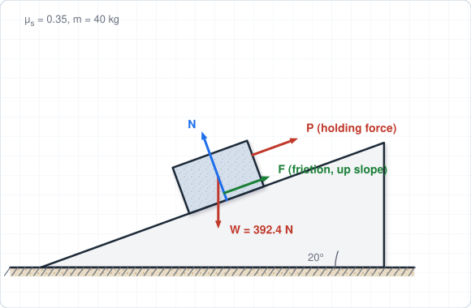
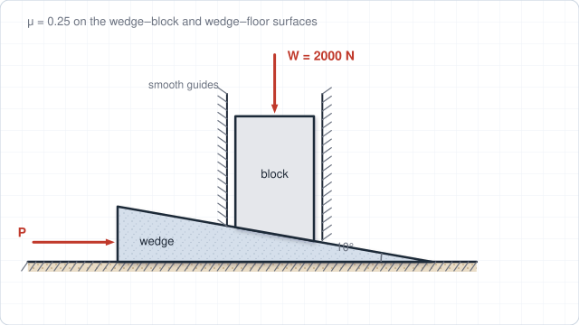
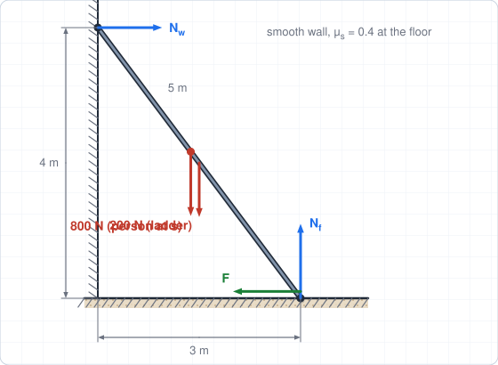
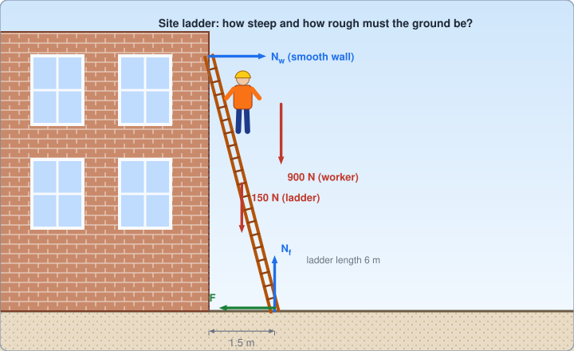
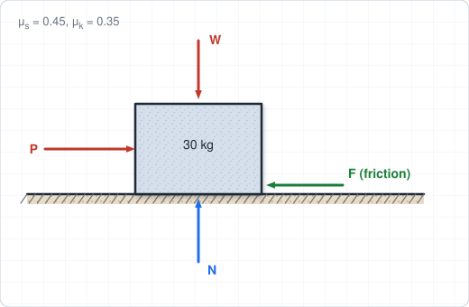
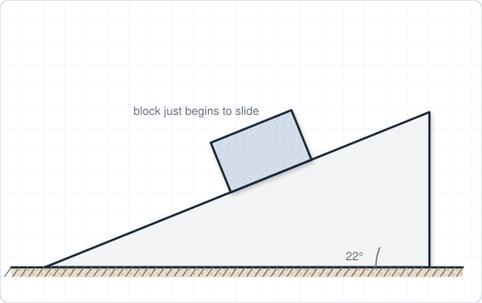
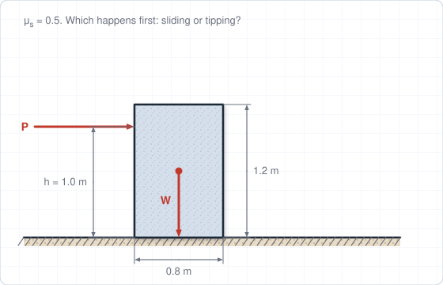
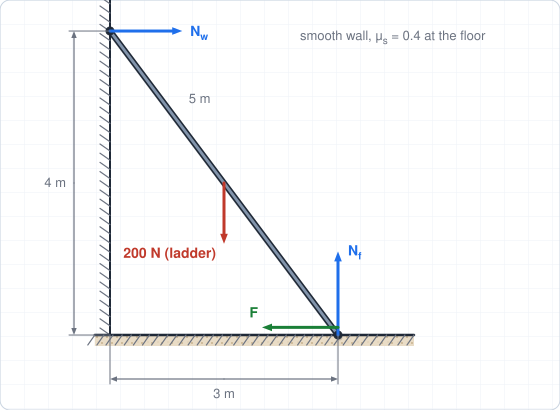
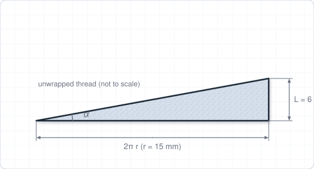
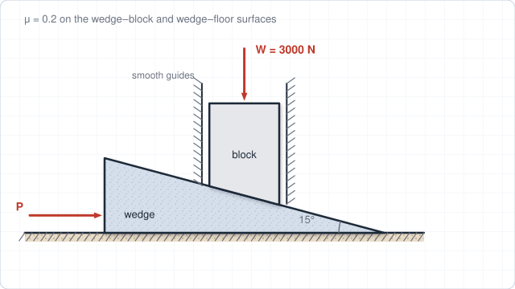

# Chapter 7 – Friction

**Weeks:** 13–14 | **CLO:** CLO6 | **Assessment:** Final Exam

::: info Textbook Mapping
**Meriam & Kraige, 7th Ed. (SI): Chapter 6, Friction**

- 6/1 Introduction; 6/2 Types of Friction; 6/3 Dry Friction
- 6/4 Wedges; 6/5 Screws
- Ladders and similar problems appear within 6/3 Dry Friction

See [Textbooks](/resources/textbooks#meriam).
:::

::: warning Chapter-number offset
Course **Ch7 = Meriam Ch6**. (Meriam Ch7, Virtual Work, is not part of this course.)
:::

## Learning Objectives

By the end of this chapter you should be able to:

- Distinguish static from kinetic friction and apply the friction laws.
- Determine whether a body slips or tips in impending-motion problems.
- Analyze wedges, screws and ladders with friction.

## Key Concepts

::: tip Real-World Application
Friction decides whether ladders, temporary works, retaining walls, foundations on soil and equipment on slopes stay in place. Site safety rules, such as the recommended ladder angle, come directly from friction and equilibrium. Wedges and screws are used to level, jack and shim structures.
:::

### 7.1 Types of Friction (Meriam 6/1, 6/2)

**Friction** is the force that resists the relative sliding of two surfaces in contact. It acts **tangent** to the surfaces and opposes the (actual or impending) motion. Meriam distinguishes:

- **Dry (Coulomb) friction** between unlubricated solid surfaces. This is the main topic of this chapter.
- **Fluid friction** between layers of a lubricating fluid (depends on viscosity and speed).
- **Internal friction** within a solid that is cyclically loaded.

### 7.2 Dry Friction (Meriam 6/3)

Let $N$ be the **normal force** between the surfaces and $F$ the friction force.

- **Static friction** (no sliding): $F$ is whatever equilibrium requires, up to a maximum:

$$
F \le F_{\max} = \mu_s N
$$

- **Impending motion** (about to slip): $F = \mu_s N$.
- **Kinetic friction** (sliding): $F = \mu_k N$, with $\mu_k < \mu_s$.

$\mu_s$ and $\mu_k$ are the **coefficients of static and kinetic friction**. They depend on the pair of materials and the surface condition, not (to a good approximation) on the contact area.

The **angle of friction** $\phi$ is the angle between the normal force and the *total* reaction (normal plus friction) when slipping is impending:

$$
\tan\phi_s = \frac{F_{\max}}{N} = \mu_s
$$

A body on an incline of angle $\theta$ is about to slide when $\tan\theta = \mu_s$ (the **angle of repose**).

### 7.3 Types of Friction Problems and Strategy

1. **Draw the FBD** and show a friction force at each contact; the direction opposes the motion or tendency of motion.
2. Identify the type of problem:
   - **Equilibrium (motion not impending):** $F$ is unknown and found from equilibrium; then **check** $F \le \mu_sN$.
   - **Impending motion at all contacts:** use $F = \mu_sN$ at those contacts.
   - **Impending motion at some contacts only:** the other friction forces are unknown. Assume which contact slips, solve, then check the other contacts.
3. **Slipping versus tipping:** compare the force needed to slip with the force needed to tip. Tipping about an edge is impending when the normal force has moved to that edge.
4. Check: friction forces found must satisfy $F \le \mu_sN$ everywhere that motion is not impending.

### 7.4 Wedges (Meriam 6/4)

A **wedge** is a simple machine that converts a force along its length into a large force perpendicular to it. Draw an FBD of each body and apply equilibrium to each, with friction acting on **every** sliding surface. At impending motion each reaction is inclined from the surface normal by the friction angle $\phi$.

If the wedge stays in place after the driving force is removed, it is **self-locking**. Check by computing the force needed to withdraw the wedge: if it is a **pull** (not zero or a push), the wedge is self-locking.

### 7.5 Screws (Meriam 6/5)

For a square-threaded screw with mean thread radius $r$, **lead** $L$ (axial advance per turn) and lead angle $\alpha$:

$$
\tan\alpha = \frac{L}{2\pi r}
$$

The moment $M$ needed to **raise** a load $W$ (turn the screw against the load) and to **lower** it are:

$$
M_{\text{raise}} = W\,r\tan(\alpha + \phi), \qquad M_{\text{lower}} = W\,r\tan(\phi - \alpha)\ \ (\text{if } \phi > \alpha)
$$

The screw is **self-locking** (it holds the load when released) if $\phi \ge \alpha$. If $\phi < \alpha$ the screw is **overhauling**: the load turns the screw by itself unless a holding moment $Wr\tan(\alpha - \phi)$ is applied.

### 7.6 Ladders and Other Equilibrium Problems

Ladder problems combine the 2D equilibrium equations with the friction limit at the base (and sometimes the wall). With a **smooth wall** the wall force is horizontal. The usual procedure:

1. Floor: $N_f = W_{\text{total}}$, $F \le \mu_sN_f$.
2. Wall: $N_w = F$ (horizontal equilibrium).
3. Moments about the base give the limiting position of a person on the ladder, or the minimum friction coefficient.

::: warning Common Mistakes
- Using $F = \mu_s N$ when motion is **not** impending. Friction is only as large as equilibrium requires, up to $\mu_s N$.
- Drawing friction in the wrong direction. It **opposes** the motion or the tendency to move.
- Assuming a block slides when it may **tip** first (or the other way round).
- Forgetting that $N$ is not always equal to $W$, for example on an incline or with an inclined applied force.
:::

## Worked Examples

### Example 7.1: Block on an incline

A 40 kg block rests on a $20^\circ$ incline with $\mu_s = 0.35$. (a) Does the block slide? (b) What is the minimum force $P$, directed up and parallel to the incline, needed to hold it? Use $g = 9.81$ m/s$^2$.

**Step 1: Forces.** $W = 40(9.81) = 392.4$ N.

$$
N = W\cos 20^\circ = 368.7\ \text{N}, \qquad W\sin 20^\circ = 134.2\ \text{N}
$$

**Step 2: Check friction.**

$$
F_{\max} = \mu_sN = 0.35(368.7) = 129.1\ \text{N}
$$

**(a)** The component of the weight along the incline (134.2 N) exceeds $F_{\max}$ (129.1 N), so the block **slides**. This agrees with $\mu_s = 0.35 < \tan 20^\circ = 0.364$.

**(b)** To hold it, friction acts up the slope at its maximum:

$$
P + F_{\max} = W\sin 20^\circ \;\Rightarrow\; P = 134.2 - 129.1 = 5.1\ \text{N}
$$

$$
\boxed{\text{The block slides; } P_{\min} \approx 5\ \text{N}}
$$

### Example 7.2: Wedge raising a load

A 2000 N load acts downward on a block that can move only vertically in smooth guides. A $10^\circ$ wedge is driven horizontally beneath the block (the wedge's top surface slopes up toward its thick end, away from the direction of motion). The coefficient of friction is $\mu = 0.25$ on both the wedge–block and wedge–floor surfaces. Find the horizontal force $P$ needed to start raising the load.

**Step 1: Block.** The wedge pushes on the block with a normal force $N_1$ (perpendicular to the sloping surface) and a friction force $\mu N_1$ along the slope. Vertical equilibrium:

$$
N_1(\cos 10^\circ - \mu\sin 10^\circ) = 2000
$$

$$
N_1 = \frac{2000}{0.9848 - 0.25(0.1736)} = 2124\ \text{N}
$$

The horizontal component of the wedge's force on the block, which is balanced by the smooth guides, is $N_1(\sin 10^\circ + \mu\cos 10^\circ) = 2124(0.4199) = 892\ \text{N}$.

**Step 2: Wedge.** By Newton's third law the block pushes the wedge down by 2000 N and back (against $P$) by 892 N. Floor: $N_2 = 2000$ N and friction $F_2 = \mu N_2 = 500$ N, opposing the motion. Horizontal equilibrium of the wedge:

$$
P - 892 - 500 = 0 \;\Rightarrow\; P = 1392\ \text{N}
$$

$$
\boxed{P \approx 1.39\ \text{kN}}
$$

**Check with the friction angle:** $\phi = \tan^{-1}0.25 = 14.04^\circ$ and $P = W[\tan(\theta + \phi) + \tan\phi] = 2000[\tan 24.04^\circ + 0.25] = 1392$ N ✓.

### Example 7.3: Ladder

A uniform ladder 5 m long weighs 200 N and leans against a smooth vertical wall, with its foot 3 m from the wall (the top is 4 m up the wall). The coefficient of static friction at the floor is $\mu_s = 0.4$. A 800 N person climbs the ladder. How far along the ladder, measured from the foot, can the person climb before the ladder slips?

**Step 1: FBD and limits.** Let $s$ be the distance along the ladder from the foot. Unknowns: $N_f$, $F$ (floor) and $N_w$ (wall, horizontal).

$$
\sum F_y = 0:\quad N_f = 200 + 800 = 1000\ \text{N}
$$

At the point of slipping:

$$
F = \mu_sN_f = 0.4(1000) = 400\ \text{N}, \qquad \sum F_x = 0:\ N_w = F = 400\ \text{N}
$$

**Step 2: Moments about the foot.** The ladder's horizontal projection per unit length is $3/5 = 0.6$.

$$
\sum M_{\text{foot}} = 0:\quad N_w(4) = 200(1.5) + 800(0.6\,s)
$$

$$
1600 = 300 + 480\,s \;\Rightarrow\; s = \frac{1300}{480} = 2.71\ \text{m}
$$

$$
\boxed{s \approx 2.71\ \text{m along the ladder}}
$$

The person can climb a little more than half the ladder's length before it slips.

### Example 7.4 (Real-world): Safe use of a site ladder

A 6 m ladder weighing 150 N rests against a building wall with its foot 1.5 m from the wall (so the top is at height $h = \sqrt{6^2 - 1.5^2} = 5.81$ m). Treat the wall as smooth. A worker weighing 900 N climbs the ladder. (a) What is the minimum coefficient of static friction at the ground needed when the worker is at the top? (b) On a dusty slab with $\mu_s = 0.20$, how far along the ladder can the worker climb before it slips?

**Step 1: Geometry.** $\cos\theta = 1.5/6 = 0.25$, so a point at distance $s$ along the ladder is $0.25\,s$ horizontally from the foot. The ladder's own weight acts at $s = 3$ m ($0.75$ m from the foot).

**Step 2: Equilibrium.**

$$
\sum F_y = 0:\quad N_f = 150 + 900 = 1050\ \text{N}
$$

$$
\sum F_x = 0:\quad N_w = F
$$

**Step 3: (a) Worker at the top** ($s = 6$ m, horizontal distance 1.5 m). Moments about the foot:

$$
N_w(5.81) = 150(0.75) + 900(1.5) = 1462.5 \;\Rightarrow\; N_w = 251.8\ \text{N}
$$

$$
\mu_{s,\min} = \frac{F}{N_f} = \frac{251.8}{1050} = 0.24
$$

**Step 4: (b) Limiting friction with $\mu_s = 0.20$.** $F_{\max} = 0.20(1050) = 210$ N, so $N_w = 210$ N:

$$
210(5.81) = 150(0.75) + 900(0.25\,s) \;\Rightarrow\; 1220 = 112.5 + 225\,s \;\Rightarrow\; s = 4.92\ \text{m}
$$

$$
\boxed{\mu_{s,\min} = 0.24, \qquad s_{\max} = 4.92\ \text{m (82\% of the ladder length)}}
$$

::: tip Engineering insight
The ladder is only safe at the top if the ground provides about 0.24 or more. On a slippery surface the ladder must be tied, footed or placed at a steeper angle. Always follow local site-safety regulations for the recommended ladder angle.
:::

## Tutorial Problems

Attempt each problem on paper before opening the answer. Full step-by-step solutions are in the [Chapter 7 solutions](/solutions/ch7-solutions).

**Problem 1 (static vs kinetic).** A 30 kg crate rests on a floor with $\mu_s = 0.45$ and $\mu_k = 0.35$. What horizontal force is needed to start it moving? What force keeps it moving at constant speed? Use $g = 9.81$ m/s$^2$.

Show answer

$N = 30(9.81) = 294.3$ N.

To start: $F = \mu_sN = 0.45(294.3) = 132$ N.

To keep moving at constant speed: $F = \mu_kN = 0.35(294.3) = 103$ N.

**Problem 2 (angle of repose).** A block on a rough plane just begins to slide when the plane is tilted to $22^\circ$. Find $\mu_s$.

Show answer

$\mu_s = \tan\theta = \tan 22^\circ = 0.40$.

**Problem 3 (slip or tip).** A uniform rectangular crate weighs $W$, is 0.8 m wide and 1.2 m tall, and sits on a floor with $\mu_s = 0.5$. A horizontal push $P$ is applied at a height $h = 1.0$ m above the floor. Does the crate slide or tip first?

Show answer

Slipping occurs at $P = \mu_sW = 0.5\,W$.

Tipping about the lower far edge occurs when $P\,h = W(0.4)$, so $P = 0.4W/1.0 = 0.4\,W$.

Since $0.4W < 0.5W$, the crate **tips first**.

**Problem 4 (ladder, no person).** For the ladder of Example 7.3 with no person on it, what friction force is required at the floor? Is the ladder stable ($\mu_s = 0.4$)?

Show answer

$N_f = 200$ N. Moments about the foot: $N_w(4) = 200(1.5) \Rightarrow N_w = 75$ N, so $F = 75$ N.

Available: $\mu_sN_f = 0.4(200) = 80$ N. Since $75 < 80$, the ladder is stable (just barely).

**Problem 5 (screw).** A square-thread screw has mean radius 15 mm and lead 6 mm, with $\mu_s = 0.2$. Find the moment needed to raise a 5 kN load. Is it self-locking? What moment is needed to lower the load?

Show answer

$\alpha = \tan^{-1}\dfrac{6}{2\pi(15)} = 3.64^\circ$, $\phi = \tan^{-1}0.2 = 11.31^\circ$.

Raise: $M = Wr\tan(\alpha + \phi) = 5000(0.015)\tan 14.95^\circ = 20.0$ N·m.

Since $\phi > \alpha$ the screw is **self-locking**. Lower: $M = Wr\tan(\phi - \alpha) = 75\tan 7.67^\circ = 10.1$ N·m.

**Problem 6 (wedge).** Repeat Example 7.2 with a $15^\circ$ wedge, $\mu = 0.2$ on both surfaces, and a 3000 N load. Find $P$.

Show answer

$\phi = \tan^{-1}0.2 = 11.31^\circ$.

$P = W[\tan(\theta + \phi) + \tan\phi] = 3000[\tan 26.31^\circ + 0.2] = 3000(0.4944 + 0.2) = 2083$ N $\approx 2.08$ kN.

## Self-Check

<ul style="list-style: none; padding-left: 0;">
  <li><label><input type="checkbox"> I can distinguish static, impending and kinetic friction and use <i>F</i> ≤ μs<i>N</i> correctly.</label></li>
  <li><label><input type="checkbox"> I can decide whether a body slides or tips.</label></li>
  <li><label><input type="checkbox"> I can analyze a wedge by drawing separate FBDs with friction on every sliding surface.</label></li>
  <li><label><input type="checkbox"> I can use <i>M</i> = <i>Wr</i> tan(α ± φ) for a screw and decide whether it is self-locking.</label></li>
  <li><label><input type="checkbox"> I can solve ladder problems using equilibrium and the friction limit.</label></li>
</ul>

<Quiz chapter="ch7" />
