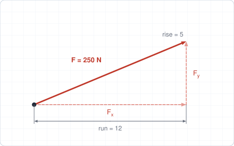
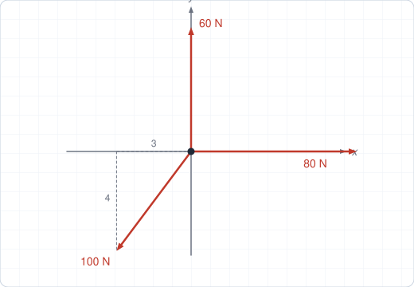
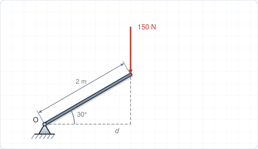
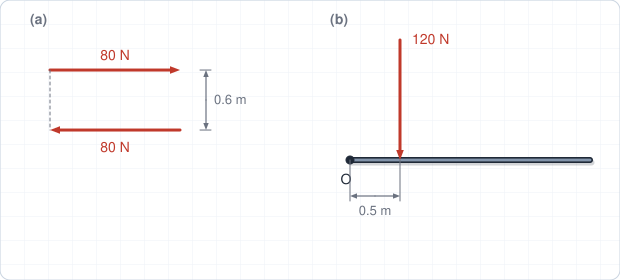
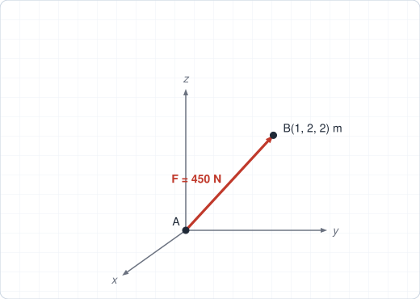
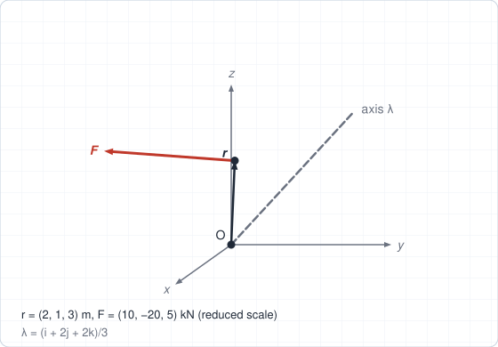

# Chapter 2 – Worked Solutions

[Back to Chapter 2](/chapters/ch2-force-systems#tutorial-problems).

## Problem 1: Components from a slope

The hypotenuse of the 12-5 triangle is $\sqrt{12^2 + 5^2} = 13$.

$$
F_x = 250\cdot\frac{12}{13} = 230.8\ \text{N}, \qquad F_y = 250\cdot\frac{5}{13} = 96.2\ \text{N}
$$

**Check:** $\sqrt{230.8^2 + 96.2^2} = 250$ N ✓.

## Problem 2: Resultant of concurrent forces

**Step 1: Third force.** Direction $(-3, -4)/5$, so $\mathbf{F}_3 = 100(-0.6, -0.8) = (-60, -80)$ N.

**Step 2: Sum.** $R_x = 80 + 0 - 60 = 20$ N, $R_y = 0 + 60 - 80 = -20$ N.

$$
R = \sqrt{20^2 + 20^2} = 28.3\ \text{N}, \qquad \alpha = \tan^{-1}\frac{-20}{20} = -45^\circ
$$

**Answer: 28.3 N, $45^\circ$ below the $+x$ axis.**

## Problem 3: Moment of a force on an inclined bar

**Method 1: perpendicular distance.** The line of action is vertical, so $d$ is the horizontal distance from $O$: $d = 2\cos 30^\circ = 1.732$ m. $M_O = Fd = 150(1.732) = 259.8$ N·m.

**Method 2: Varignon.** The tip is at $(1.732, 1.0)$ m and $\mathbf{F} = (0, -150)$ N:

$$
M_O = x\,F_y - y\,F_x = (1.732)(-150) - (1.0)(0) = -259.8\ \text{N·m}
$$

**Answer: 259.8 N·m clockwise.** Both methods agree.

## Problem 4: Couple and force–couple system

**(a)** $M = Fd = 80(0.6) = 48$ N·m. A couple has the same moment about every point.

**(b)** Move the force to $O$ and add the moment it had about $O$: $\mathbf{r} = 0.5\,\mathbf{i}$ m, $\mathbf{F} = -120\,\mathbf{j}$ N,

$$
\mathbf{M}_O = \mathbf{r}\times\mathbf{F} = (0.5)(-120)\,\mathbf{k} = -60\,\mathbf{k}\ \text{N·m}
$$

**Answer: 120 N downward at $O$, plus a 60 N·m clockwise couple.**

## Problem 5: 3D force along a line

**Step 1: Unit vector.** $\mathbf{r}_{AB} = (1, 2, 2)$, $|\mathbf{r}_{AB}| = 3$ m, $\mathbf{n} = (1, 2, 2)/3$.

**Step 2: Force.** $\mathbf{F} = 450\,\mathbf{n} = 150\,\mathbf{i} + 300\,\mathbf{j} + 300\,\mathbf{k}$ N.

**Step 3: Direction angles.** $\theta_x = \cos^{-1}(1/3) = 70.5^\circ$ and $\theta_y = \theta_z = \cos^{-1}(2/3) = 48.2^\circ$.

**Check:** $(1/3)^2 + (2/3)^2 + (2/3)^2 = 1$ ✓.

## Problem 6: Moment about an axis

**Step 1: $\mathbf{M}_O$.** With $\mathbf{r} = (2, 1, 3)$ m and $\mathbf{F} = (10, -20, 5)$ kN:

$$
\mathbf{M}_O = (1\cdot 5 - 3(-20))\,\mathbf{i} + (3\cdot 10 - 2\cdot 5)\,\mathbf{j} + (2(-20) - 1\cdot 10)\,\mathbf{k} = 65\,\mathbf{i} + 20\,\mathbf{j} - 50\,\mathbf{k}\ \text{kN·m}
$$

**Step 2: Project on the axis.**

$$
M_\lambda = \boldsymbol{\lambda}\cdot\mathbf{M}_O = \frac{(1)(65) + (2)(20) + (2)(-50)}{3} = \frac{5}{3} = 1.67\ \text{kN·m}
$$

**Check:** $\mathbf{r}\cdot\mathbf{M}_O = 130 + 20 - 150 = 0$ ✓.
