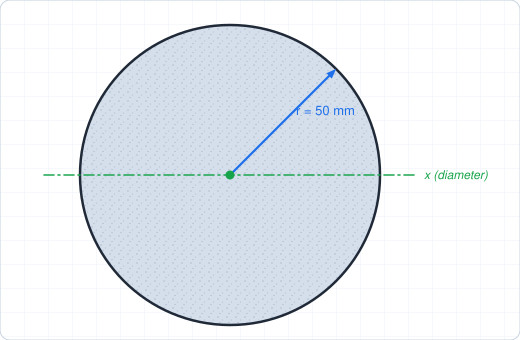
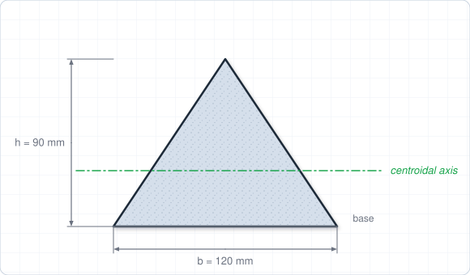
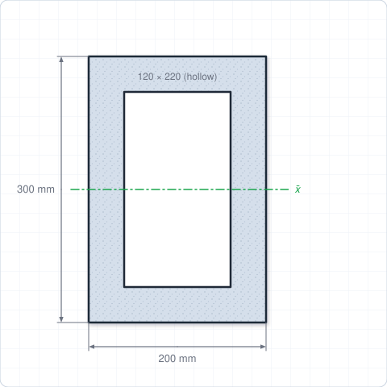
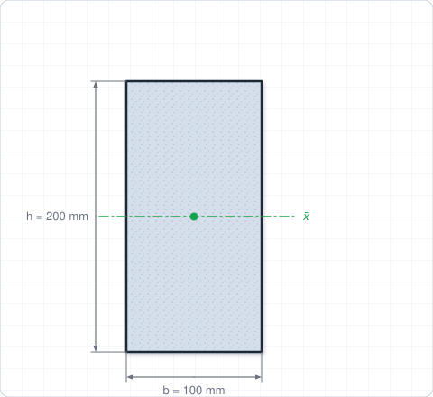
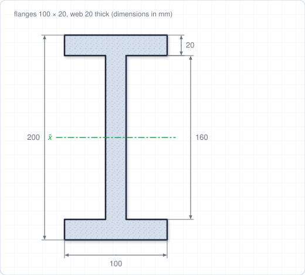
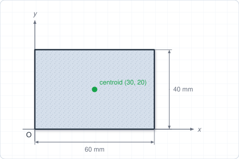
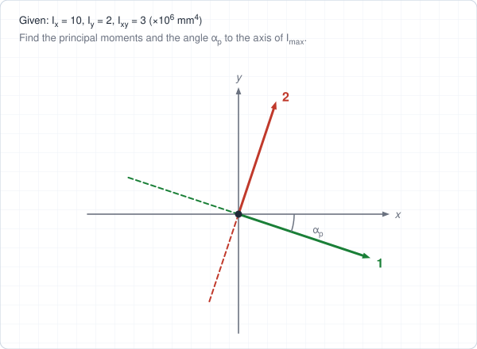

# Chapter 6 – Worked Solutions

[Back to Chapter 6](/chapters/ch6-moments-inertia#tutorial-problems).

## Problem 1: Circle

For a circle of radius $r = 50$ mm:

$$
I = \frac{\pi r^4}{4} = \frac{\pi(50)^4}{4} = 4.91\times 10^{6}\ \text{mm}^4, \qquad J = \frac{\pi r^4}{2} = 9.82\times 10^{6}\ \text{mm}^4
$$

**Check:** $J = I_x + I_y = 2I$ ✓.

## Problem 2: Triangle

**About the base:** $I = \dfrac{bh^3}{12} = \dfrac{120(90)^3}{12} = 7.29\times 10^{6}$ mm$^4$.

**About the parallel centroidal axis** (at $h/3 = 30$ mm above the base): $\bar{I} = \dfrac{bh^3}{36} = 2.43\times 10^{6}$ mm$^4$.

**Check with the parallel-axis theorem:** $A = \tfrac{1}{2}(120)(90) = 5400$ mm$^2$, so

$$
\bar{I} = I - Ad^2 = 7.29\times 10^{6} - 5400(30)^2 = 2.43\times 10^{6}\ \text{mm}^4 \;✓
$$

## Problem 3: Hollow rectangle

Subtract the void from the outer rectangle (both centered, so the same centroidal axis):

$$
\bar{I}_x = \frac{200(300)^3}{12} - \frac{120(220)^3}{12} = 450\times 10^{6} - 106.5\times 10^{6} = 343.5\times 10^{6}\ \text{mm}^4
$$

**Answer: $3.44\times 10^{8}$ mm$^4$.**

## Problem 4: Radius of gyration

$$
\bar{I} = \frac{100(200)^3}{12} = 66.7\times 10^{6}\ \text{mm}^4, \qquad A = 20\,000\ \text{mm}^2
$$

$$
k = \sqrt{\frac{\bar{I}}{A}} = \sqrt{3333} = 57.7\ \text{mm} \quad\left(= \frac{h}{\sqrt{12}}\right)
$$

## Problem 5: I-section

**Method 1: bounding rectangle minus voids.** The two voids are each 40 mm wide and 160 mm tall (80 mm wide in total):

$$
\bar{I}_x = \frac{100(200)^3 - 80(160)^3}{12} = \frac{800\times 10^{6} - 327.7\times 10^{6}}{12} = 39.4\times 10^{6}\ \text{mm}^4
$$

**Method 2 (check).** Each flange: $\frac{100(20)^3}{12} + 2000(90)^2 = 0.067\times 10^6 + 16.2\times 10^6 = 16.27\times 10^6$. Web: $\frac{20(160)^3}{12} = 6.83\times 10^6$. Total $= 2(16.27) + 6.83 = 39.4\times 10^{6}$ mm$^4$ ✓.

## Problem 6: Product of inertia

The rectangle is symmetric about its own centroidal axes, so $\bar{I}_{xy} = 0$. The centroid is at $(30, 20)$ mm and $A = 2400$ mm$^2$:

$$
I_{xy} = \bar{I}_{xy} + A\,d_x d_y = 0 + 2400(30)(20) = 1.44\times 10^{6}\ \text{mm}^4
$$

## Problem 7: Principal moments of inertia

$$
\frac{I_x + I_y}{2} = 6, \qquad \frac{I_x - I_y}{2} = 4, \qquad R = \sqrt{4^2 + 3^2} = 5\quad(\times 10^{6}\ \text{mm}^4)
$$

$$
I_{\max} = 6 + 5 = 11\times 10^{6}\ \text{mm}^4, \qquad I_{\min} = 6 - 5 = 1\times 10^{6}\ \text{mm}^4
$$

**Orientation:**

$$
\tan 2\alpha_p = \frac{-2I_{xy}}{I_x - I_y} = \frac{-6}{8} = -0.75 \;\Rightarrow\; 2\alpha_p = -36.9^\circ, \quad \alpha_p = -18.4^\circ
$$

**Which is which?** At $\alpha = -18.4^\circ$:

$$
I_{x'} = 6 + 4\cos(-36.9^\circ) - 3\sin(-36.9^\circ) = 6 + 3.2 + 1.8 = 11
$$

So $I_{\max}$ is along the axis $18.4^\circ$ clockwise from $x$, and $I_{\min}$ is along the perpendicular axis.
